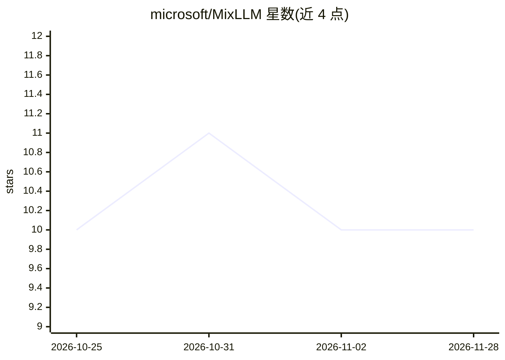

# microsoft/MixLLM

⭐ 10 · C++ · MIT · 推送 2026-03-31 · [GitHub](https://github.com/microsoft/MixLLM) · 组织维护

**面向研究者的 LLM 混合精度量化推理框架**

微软开源的 LLM 量化框架：在单个线性层内按 output-feature 维度混合 4-bit 与 8-bit 权重（如 W4.4A8，激活分组 8-bit），配合高效 kernel 设计加速推理。提供源码安装与 Docker 镜像，附 test_kernel.py 供调节矩阵维度与量化比例参数测试 kernel 性能；通过 run.sh 一键执行校准、量化与 fake quantization 仿真评估；另提供针对 vLLM v0.9.0 的补丁以在 vLLM 中评测量化模型准确率（GSM8K）与推理性能基准。附论文引用信息。

## 筛选速览

| 维度 | 判定 | 备注 |
|---|---|---|
| AI 角色 | `ai-ecosystem` | LLM/agent 周边工具 |
| 许可风险 | `permissive` | MIT |
| 部署形态 | `self-host` | docker 或自建部署 |
| 模型依赖 | local-ok | 支持本地模型 |
| 硬件要求 | — | 无带数字的原话,不猜 |
| 安装摩擦 | `low` | 无编译、无系统依赖或容器化 |
| 成熟度 | — | 结构信号不足 |

## 能力要点

- 单线性层内混合 4-bit/8-bit 权重量化（-r 参数调节 INT8 比例）
- test_kernel.py 可调参数测试混合精度 kernel 性能
- run.sh 一步完成校准、量化与 fake quantization 评估
- 提供 vLLM v0.9.0 补丁以集成量化模型并跑 GSM8K/基准测试

## 适用场景

- 对 LLM 权重做 4/8-bit 混合精度量化以降低部署资源占用
- 用 fake quantization 流程在无低精度硬件时评估量化精度
- 在 vLLM 中加载量化模型评测准确率与吞吐

## 场景标签

`模型量化` · 领域:训练与推理

## 证据(README 行号)

> L3: This repository contains the source code for **MixLLM**, an innovative framework for mixed-precision quantization de
> L82: ## 4\. Integration with vllm Framework

## 星数曲线

2026-10-25 10 → 2026-11-28 10（+0）

---
*卡片 v1 · prompt 1.4 · 生成 2026-11-19 · 置信度 high · 依据 README sha `c8a866735f6c` · [字段定义](../../DATASET.md)*
