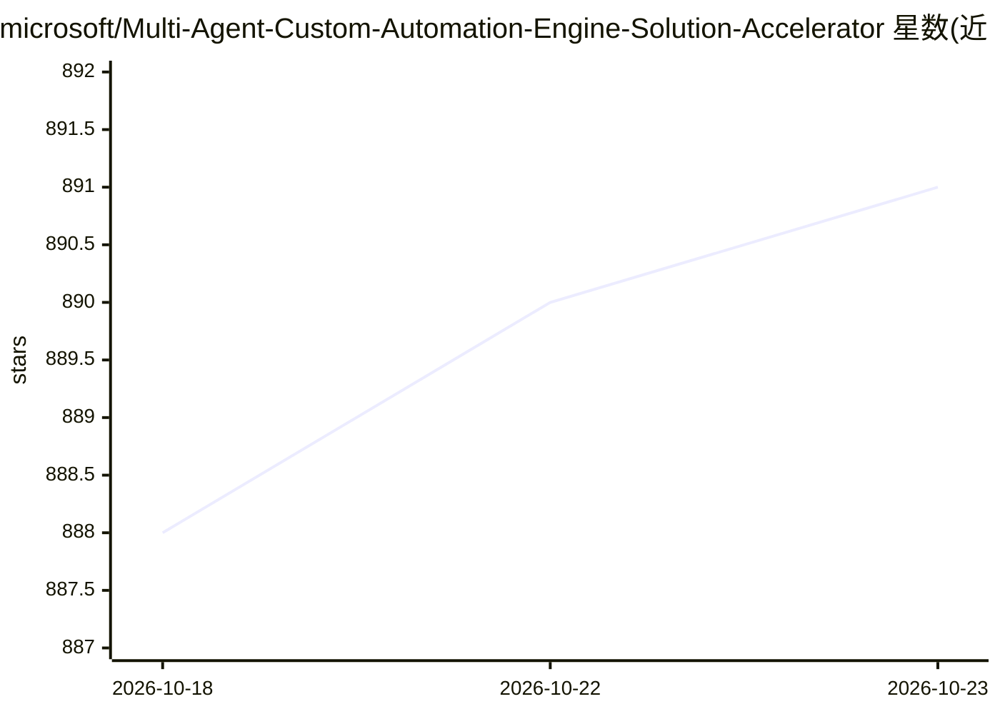

# microsoft/Multi-Agent-Custom-Automation-Engine-Solution-Accelerator

⭐ 891 · Python · MIT · 推送 2026-10-21 · [GitHub](https://github.com/microsoft/Multi-Agent-Custom-Automation-Engine-Solution-Accelerator) · 组织维护

**面向企业的多 AI Agent 任务自动化参考应用（Azure 部署模板）**

微软提供的解决方案加速器：用户指定任务后，由一组专门化 AI Agent 协作完成规划、执行与校验。基于 Microsoft Agent Framework 与 Azure Foundry（模型侧）、Azure Cosmos DB（元数据与结果存储）、Azure Container Apps（前端托管）、Azure AI Search（向量检索）构建。通过 Azure Developer CLI（azd ≥1.18.0，本地部署另需 Bicep ≥0.33.0）部署到用户自己的 Azure 订阅，资源按用量计费。README 给出营销发布计划、员工入职、RFP 审查、合同合规审查、内容生成等业务场景，并附带安全指引（Key Vault、Managed Identity）。

## 筛选速览

| 维度 | 判定 | 备注 |
|---|---|---|
| AI 角色 | `ai-ecosystem` | LLM/agent 周边工具 |
| 许可风险 | `permissive` | MIT |
| 部署形态 | `None` |  |
| 模型依赖 | locked-api |  |
| 硬件要求 | — | 无带数字的原话,不猜 |
| 安装摩擦 | `low` | 无编译、无系统依赖或容器化 |
| 成熟度 | — | 结构信号不足 |

## 能力要点

- 多专门化 Agent 协作完成任务规划、执行与校验
- 基于 Microsoft Agent Framework、Azure Foundry、Cosmos DB、Azure AI Search 的参考架构
- 通过 azd 一键部署到 Azure 订阅
- 内置 Azure Key Vault 与 Managed Identity 的安全配置

## 适用场景

- 在企业内部自动化需要跨部门协调的复杂流程
- 用 AI Agent 团队加速 RFP/合同的合规审查
- 基于可扩展模板搭建自己的多 Agent 编排应用

## 场景标签

`多智能体` · 领域:Agent 开发

## 证据(README 行号)

> L3: Welcome to the *Multi-Agent Custom Automation Engine* solution accelerator, designed to help businesses leverage AI 
> L7: The Multi-Agent Custom Automation Engine solution accelerator allows users to specify tasks and have them automatica
> L15: The solution leverages Azure OpenAI Service, Azure Container Apps, Azure Cosmos DB, and Azure Container Registry to

## 星数曲线

2026-10-18 888 → 2026-10-23 891（+3）

---
*卡片 v1 · prompt 1.4 · 生成 2026-10-21 · 置信度 high · 依据 README sha `1bcb6b507bfa` · [字段定义](../../DATASET.md)*
