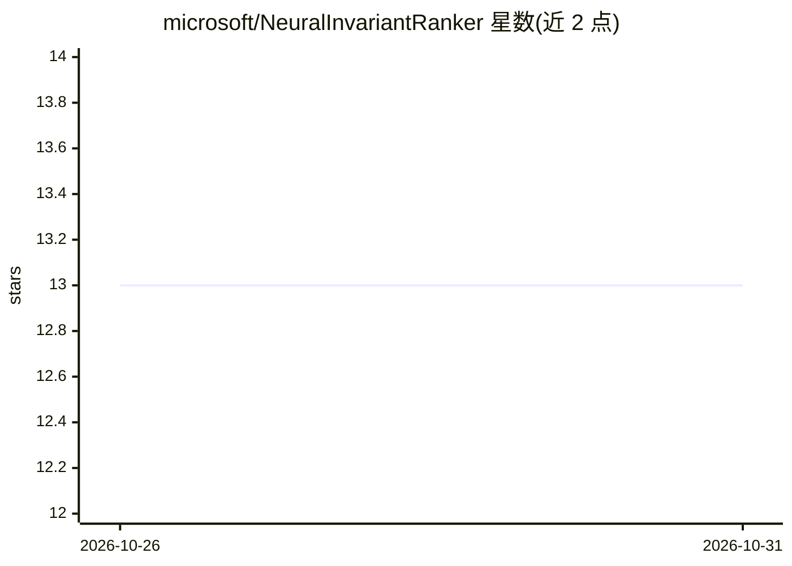

# microsoft/NeuralInvariantRanker

⭐ 13 · Slash · MIT · 推送 2026-10-26 · [GitHub](https://github.com/microsoft/NeuralInvariantRanker) · 组织维护

**对 LLM 生成的循环不变式进行排序，用于程序验证**

EMNLP 2023 论文的官方代码发布：训练一个神经 ranker，对 GPT-3.5/GPT-4 生成的循环不变式候选排序，将更可能正确的候选排到前列，以减少程序验证器（Z3）的调用次数。流程包括数据处理、用 OpenAI/Azure 嵌入模型（ada_002 等）收集初始嵌入、训练 ranker、5 折交叉验证评估与可视化。已知限制：假设 LLM 调用成本可忽略；嵌入文件大（12GB/34GB）且全量载入内存；未在真实部署场景验证前不保证排序正确性。

## 筛选速览

| 维度 | 判定 | 备注 |
|---|---|---|
| AI 角色 | `ai-native` | 本体是模型或模型工具 |
| 许可风险 | `permissive` | MIT |
| 部署形态 | `library` | 以包/库形式分发 |
| 模型依赖 | locked-api |  |
| 硬件要求 | — | 无带数字的原话,不猜 |
| 安装摩擦 | `medium` | 含编译或系统依赖之一 |
| 成熟度 | — | 结构信号不足 |

## 能力要点

- 训练神经 ranker 对 LLM 生成的循环不变式排序，输出 code_vector 与 similarity
- 支持 OpenAI API 与 Azure OpenAI API 收集初始嵌入，可扩展自定义 Embedder
- 提供训练数据 zip 与 5 折交叉验证评估、可视化 notebook
- 附 LLM 生成不变式的 prompt 模板（chat.py）

## 适用场景

- 对 LLM 生成的多个不变式候选排序，减少验证器调用
- 复现论文中 GPT-3.5/GPT-4 生成不变式的排序实验
- 在程序验证流水线中为其他问题定制不变式排序

## 场景标签

`科研工具` · 领域:学习与行业

## 证据(README 行号)

> L3: Official code release of out EMNLP 2023 work NeuralInvariantRanker.
> L6: The tool is used for ranking LLM-generated Loop Invariants. We evaluate the invariants from two different LLMs (`gpt

## 星数曲线

2026-10-26 13 → 2026-10-31 13（+0）

---
*卡片 v1 · prompt 1.4 · 生成 2026-10-31 · 置信度 high · 依据 README sha `a75bf0a57775` · [字段定义](../../DATASET.md)*
