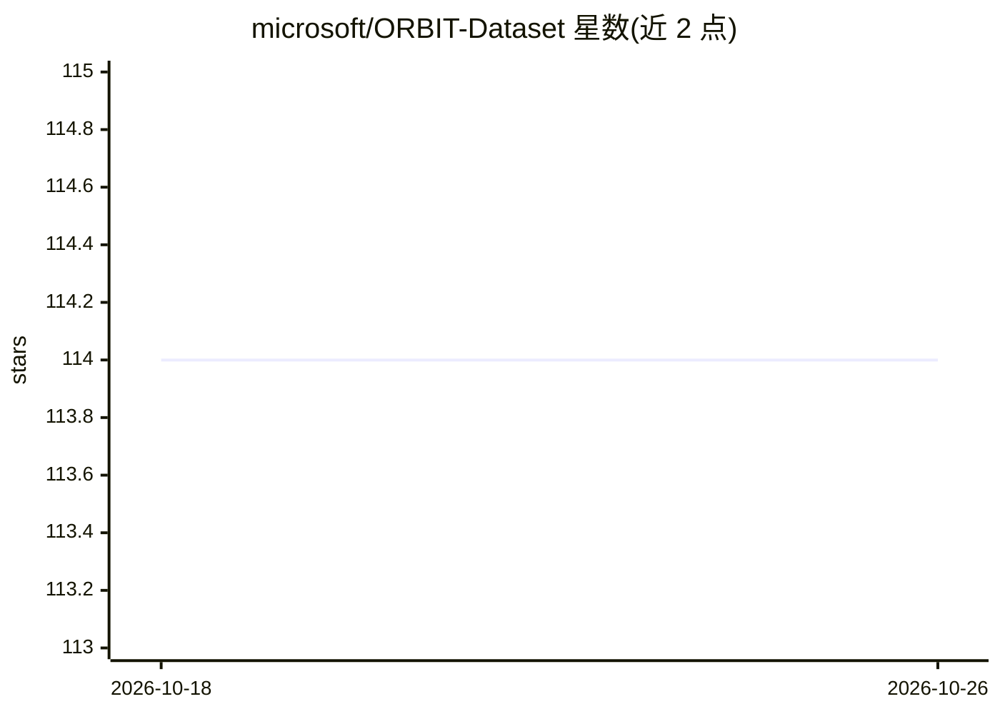

# microsoft/ORBIT-Dataset

⭐ 114 · Python · MIT · 推送 2026-07-17 · [GitHub](https://github.com/microsoft/ORBIT-Dataset) · 组织维护

**视障人士拍摄的真实少样本物体识别数据集与基准**

ORBIT 是由盲人/低视力用户用手机在干净与杂乱场景中拍摄的视频数据集，配套可教学物体识别基准任务，用于推动少样本学习研究。仓库提供数据集下载与预处理脚本、统计汇总脚本，以及 4 个少样本基线模型（CNAPs、Simple CNAPs、ProtoNets、FineTuner）的训练与测试代码，基于 PyTorch 1.13.1 与 Python 3.7。LITE 训练方式支持在单块 GPU 上以 224x224 大尺寸帧训练。基准包含明确的训练/测试协议（2022 年 12 月更新，每测试用户 50 任务、每杂乱视频采样 200 帧）。

## 筛选速览

| 维度 | 判定 | 备注 |
|---|---|---|
| AI 角色 | `ai-knowledge` | 知识聚合/清单类 |
| 许可风险 | `permissive` | MIT |
| 部署形态 | `None` |  |
| 模型依赖 | — | README 未给出锁定关系 |
| 硬件要求 | — | 无带数字的原话,不猜 |
| 安装摩擦 | `low` | 无编译、无系统依赖或容器化 |
| 成熟度 | — | 结构信号不足 |

## 能力要点

- 由盲人/低视力用户手机拍摄的真实场景视频数据集（干净+杂乱）
- 少样本可教学物体识别基准，含明确的训练/个性化/评测协议
- 提供 4 个基线模型（CNAPs、Simple CNAPs、ProtoNets、FineTuner）实现
- LITE 训练支持单 GPU 上以 224x224 大帧训练

## 适用场景

- 在真实世界数据上评测少样本/元学习方法
- 研究面向视障用户的个性化物体识别
- 复现两篇论文（数据集论文与 LITE 论文）的实验结果

## 场景标签

`模型评测` · 领域:评测与运维

## 证据(README 行号)

> L1: # ORBIT: A Real-World Few-Shot Dataset for Teachable Object Recognition
> L4: - ORBIT: A Real-World Few-Shot Dataset for Teachable Object Recognition. Code is provided to download and prepare th

## 星数曲线

2026-10-18 114 → 2026-10-26 114（+0）

---
*卡片 v1 · prompt 1.4 · 生成 2026-10-23 · 置信度 high · 依据 README sha `7f39eb72145b` · [字段定义](../../DATASET.md)*
