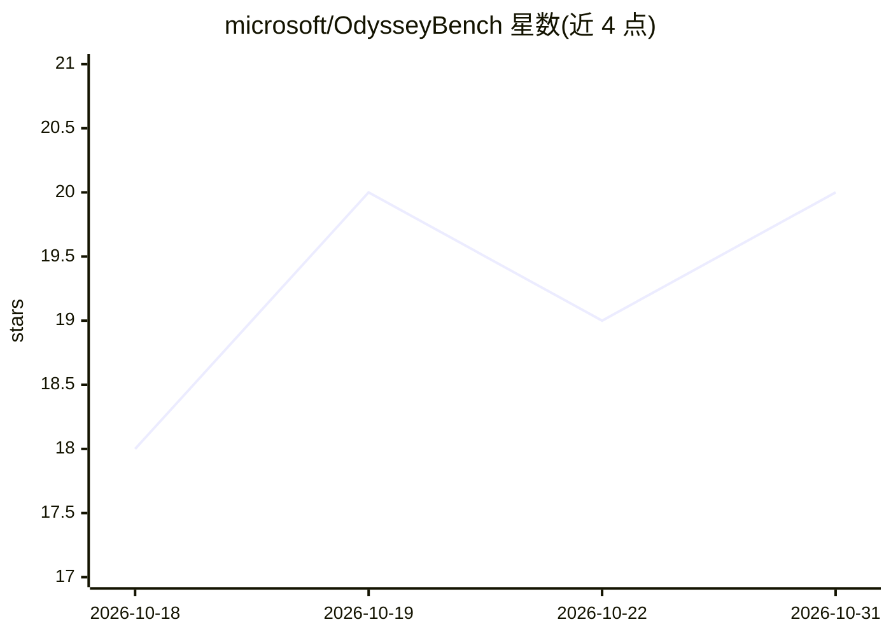

# microsoft/OdysseyBench

⭐ 20 · Jupyter Notebook · MIT · 推送 2026-06-11 · [GitHub](https://github.com/microsoft/OdysseyBench) · 组织维护

**评测 LLM agent 长程办公工作流记忆能力的基准套件**

微软发布的基准与评测套件，含 OdysseyBench+ 与 OdysseyBench-Neo 两个赛道，面向任务型 agent 系统，聚焦记忆与 RAG 能力。提供任务生成、执行、验证与性能评估工具；记忆评测支持 raw_chat 长上下文、use_rag（四种 rag_mode 与 top_k 配置）与 clean 模式；Neo 赛道支持合成任务生成、交叉验证与 LLM-as-a-judge 生成任务评估。基于 OfficeBench 材料构建，通过 conda 环境与 pip 依赖运行，需设置 OPENAI_API_KEY。

## 筛选速览

| 维度 | 判定 | 备注 |
|---|---|---|
| AI 角色 | `ai-ecosystem` | LLM/agent 周边工具 |
| 许可风险 | `permissive` | MIT |
| 部署形态 | `library` | 以包/库形式分发 |
| 模型依赖 | — | README 未给出锁定关系 |
| 硬件要求 | — | 无带数字的原话,不猜 |
| 安装摩擦 | `low` | 无编译、无系统依赖或容器化 |
| 成熟度 | — | 结构信号不足 |

## 能力要点

- OdysseyBench+ / OdysseyBench-Neo 双赛道评测
- 记忆模式覆盖长上下文、RAG（4 种 rag_mode）与 clean
- Neo 任务合成生成与交叉验证清洗工具链
- LLM-as-a-judge 生成任务评估

## 适用场景

- 评测我的 agent 在长程办公工作流中的记忆表现
- 对比长上下文与 RAG 两种记忆策略的执行成功率
- 合成并清洗生成自己的评测任务

## 场景标签

`模型评测` · 领域:评测与运维

## 证据(README 行号)

> L3: OdysseyBench is a comprehensive benchmark and evaluation suite for task-oriented agent systems, supporting both the 
> L129: If you found this code useful, please cite the following paper:

## 星数曲线

2026-10-18 18 → 2026-10-31 20（+2）

---
*卡片 v1 · prompt 1.4 · 生成 2026-10-28 · 置信度 mid · 依据 README sha `4cd8bab88b01` · [字段定义](../../DATASET.md)*
