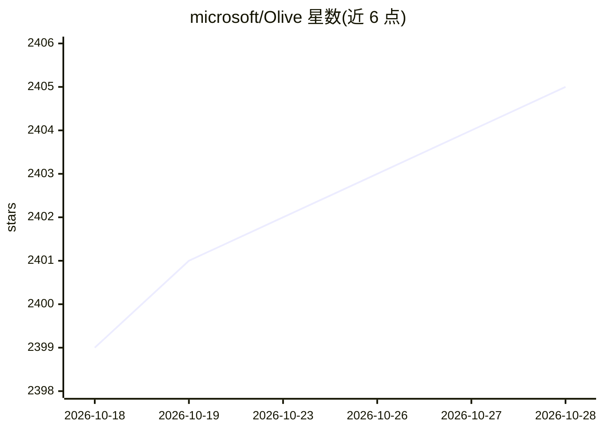

# microsoft/Olive

⭐ 2,406 · Python · MIT · 推送 2026-10-28 · [GitHub](https://github.com/microsoft/Olive) · [官网](https://microsoft.github.io/Olive/) · 组织维护

**微软的 ONNX 模型优化工具链：量化/转换/微调适配多硬件**

面向 ONNX Runtime 的模型优化工具包：给定模型与目标硬件（CPU/GPU/NPU），自动组合量化、图优化等技术，在精度与延迟约束下产出用于云端或边缘推理的 ONNX 模型。提供 olive-ai pip 包与 Olive CLI，自动优化器可从 Hugging Face 拉取模型（如 Qwen2.5-0.5B）执行 GPTQ int4 量化并优化 ONNX 图；Llama、Phi、Qwen、Gemma 等主流架构开箱支持，其他架构可通过 io_config 接入。含遥测数据收集。

## 筛选速览

| 维度 | 判定 | 备注 |
|---|---|---|
| AI 角色 | `ai-ecosystem` | LLM/agent 周边工具 |
| 许可风险 | `permissive` | MIT |
| 部署形态 | `library` | 以包/库形式分发 |
| 模型依赖 | — | README 未给出锁定关系 |
| 硬件要求 | — | 无带数字的原话,不猜 |
| 安装摩擦 | `low` | 无编译、无系统依赖或容器化 |
| 成熟度 | — | 结构信号不足 |

## 能力要点

- 自动优化器：拉取 HF 模型→GPTQ int4 量化→ONNX 图捕获与优化
- Olive CLI 命令行工作流，支持 PowerShell
- 面向 CPU/GPU/NPU 多硬件的优化技术组合
- Llama/Phi/Qwen/Gemma 等架构开箱支持，可扩展 io_config

## 适用场景

- 把 Hugging Face 上的 LLM 量化为 int4 ONNX 模型部署
- 针对特定硬件在精度/延迟约束下做模型优化
- 通过 CLI 批量优化模型用于边缘设备推理

## 场景标签

`模型量化` · 领域:训练与推理

## 证据(README 行号)

> L8: Given a model and targeted hardware, Olive (abbreviation of **O**nnx **LIVE**) composes the best suitable optimizati
> L95: Olive can automatically optimize popular model *architectures* like Llama, Phi, Qwen, Gemma, etc out-of-the-box - s

## 星数曲线

2026-10-18 2,399 → 2026-10-28 2,405（+6）

---
*卡片 v1 · prompt 1.4 · 生成 2026-10-21 · 置信度 high · 依据 README sha `e3f213e648eb` · [字段定义](../../DATASET.md)*
