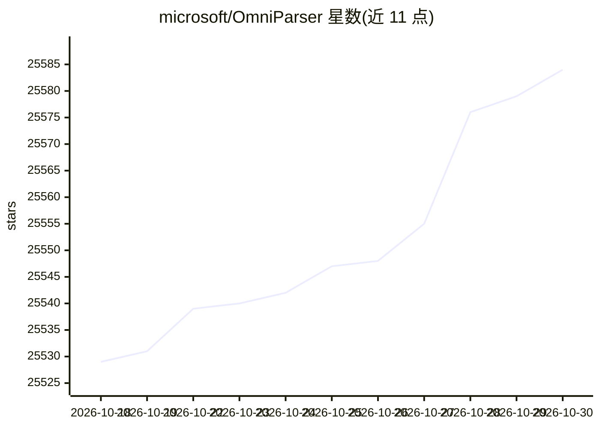

# microsoft/OmniParser

⭐ 25,584 · Jupyter Notebook · CC-BY-4.0 · 推送 2026-07-20 · [GitHub](https://github.com/microsoft/OmniParser) · 组织维护

**为视觉 GUI Agent 解析界面截图的结构化工具**

微软发布的屏幕解析工具：将用户界面截图解析为结构化、易于理解的元素，供 GPT-4V 等视觉模型将动作准确定位到界面区域。配套 OmniTool 可用视觉模型控制 Windows 11 虚拟机，支持 OpenAI、DeepSeek、Qwen 与 Anthropic Computer Use 等模型。提供交互区域检测模型（YOLOv9-E）与图标功能描述模型，权重托管于 Hugging Face；通过 conda/pip 安装，附带 Gradio demo 与 demo.ipynb 示例。

## 筛选速览

| 维度 | 判定 | 备注 |
|---|---|---|
| AI 角色 | `ai-native` | 本体是模型或模型工具 |
| 许可风险 | `dual` | CC-BY-4.0 |
| 部署形态 | `library` | 以包/库形式分发 |
| 模型依赖 | — | README 未给出锁定关系 |
| 硬件要求 | — | 无带数字的原话,不猜 |
| 安装摩擦 | `low` | 无编译、无系统依赖或容器化 |
| 成熟度 | — | 结构信号不足 |

## 动量与使用信号

- 维护:`maintenance` — 距上次 push 90.3 天,年发版 0,10 位贡献者
- 涨星:近 1 天 **+2**(自 20261016 起算)
- 平台:WINDOWS · 协议:—

## 能力要点

- 将 UI 截图解析为结构化可交互元素
- 交互区域检测模型（YOLOv9-E）与图标描述模型（Florence caption）
- OmniTool 支持接入多家视觉模型控制 Windows 11 VM
- Hugging Face Space 在线 demo 与 gradio_demo.py 本地 demo

## 适用场景

- 为 GUI 自动化 Agent 提供屏幕元素定位
- 用 OmniParser+OmniTool 在本地轨迹日志上构建训练数据管线
- 在 Hugging Face Space 或本地 Gradio 中试解析效果

## 场景标签

`GUI 自动化` · 领域:效率与自动化

## 证据(README 行号)

> L1: # OmniParser: Screen Parsing tool for Pure Vision Based GUI Agent
> L10: **OmniParser** is a comprehensive method for parsing user interface screenshots into structured and easy-to-underst
> L17: - [2025/2] We introduce OmniTool: Control a Windows 11 VM with OmniParser + your vision model of choice. OmniTool s

## 星数曲线

2026-10-18 25,529 → 2026-10-30 25,584（+55）

---
*卡片 v1 · prompt 1.4 · 生成 2026-10-18 · 置信度 high · 依据 README sha `95de138747ad` · [字段定义](../../DATASET.md)*
