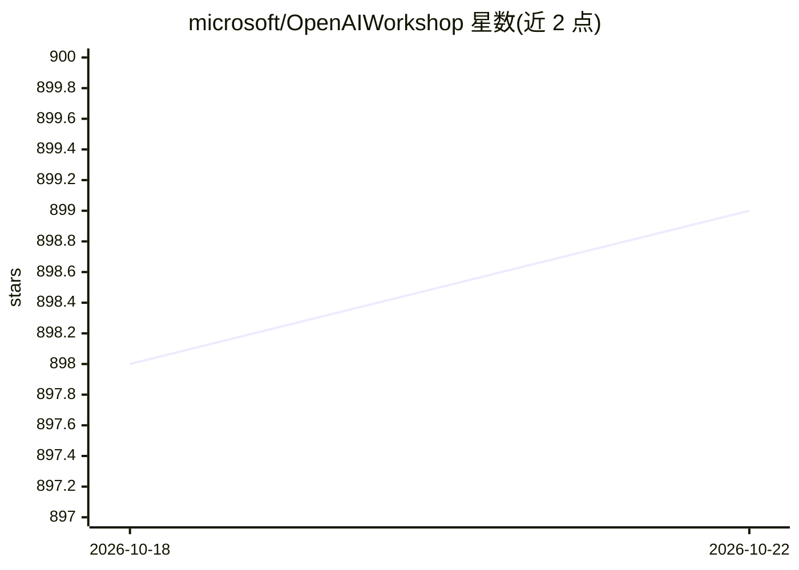

# microsoft/OpenAIWorkshop

⭐ 898 · Python · MIT · 推送 2026-10-22 · [GitHub](https://github.com/microsoft/OpenAIWorkshop) · 组织维护

**微软官方 AI Agent 工作坊：基于 Azure 的智能体方案教学材料**

微软维护的 AI Agentic Workshop 仓库，提供设计、原型和对比各类 agent 方案所需的代码与文档：涵盖单智能体与多智能体（Magentic 编排、handoff 路由）、Microsoft Agent Framework、MCP 工具服务端、混合 Workflow + Durable Task 编排、Application Insights 可观测性与 Grafana 面板、React/Streamlit 前端。面向在 Azure 上构建企业级 agentic AI 系统的开发者，提供 Azure Developer CLI 一键部署及 Terraform/Bicep IaC、CI/CD、VNet 等企业安全部署方式。

## 筛选速览

| 维度 | 判定 | 备注 |
|---|---|---|
| AI 角色 | `ai-knowledge` | 知识聚合/清单类 |
| 许可风险 | `permissive` | MIT |
| 部署形态 | `None` |  |
| 模型依赖 | — | README 未给出锁定关系 |
| 硬件要求 | — | 无带数字的原话,不猜 |
| 安装摩擦 | `low` | 无编译、无系统依赖或容器化 |
| 成熟度 | — | 结构信号不足 |

## 能力要点

- 单智能体与多智能体架构（Magentic 编排、handoff 域路由）模式指南
- MCP 工具服务端集成，含认证、RBAC 与 APIM 集成
- 混合 Workflow + Durable Task 编排，支持 fan-out/fan-in 与 human-in-the-loop
- Application Insights 全链路追踪与预置 Grafana 面板

## 适用场景

- 学习并原型化 Azure 上的多智能体业务解决方案
- 参考企业级 agent 部署架构（VNet、私有端点、托管标识、CI/CD）
- 为 agent 系统接入可观测性与评估流程

## 场景标签

`教程课程` · 领域:学习与行业

## 证据(README 行号)

> L4: Welcome to the official repository for the Microsoft AI Agentic Workshop! This repository provides all the resources
> L20: - **Design and prototype AI agent solutions** for real-world business scenarios

## 星数曲线

2026-10-18 898 → 2026-10-22 899（+1）

---
*卡片 v1 · prompt 1.4 · 生成 2026-10-21 · 置信度 high · 依据 README sha `19b482d95fe3` · [字段定义](../../DATASET.md)*
