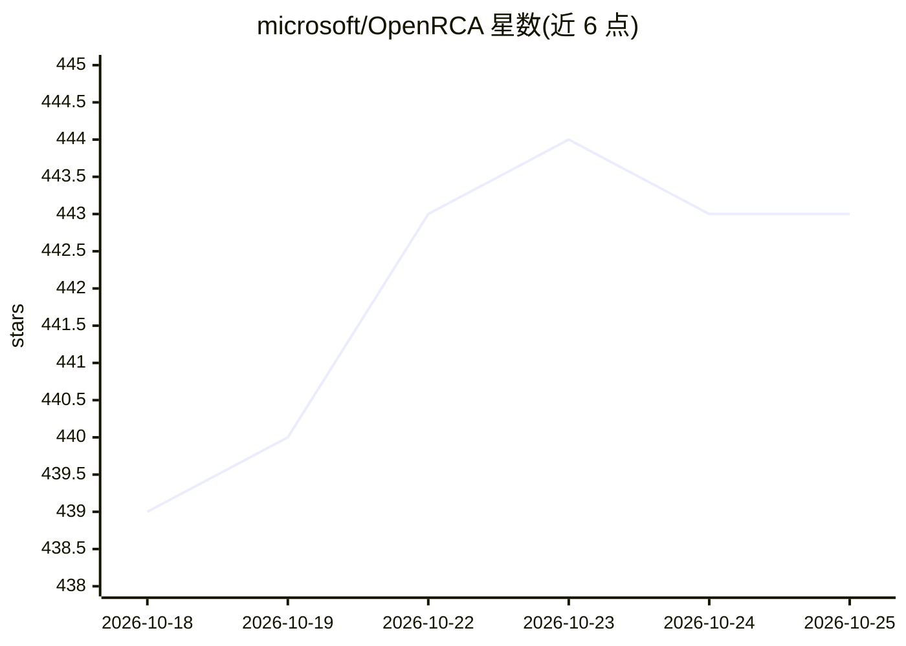

# microsoft/OpenRCA

⭐ 443 · Python · MIT · 推送 2026-10-22 · [GitHub](https://github.com/microsoft/OpenRCA) · [官网](https://aka.ms/openrca) · 组织维护

**评测 LLM 软件故障根因分析能力的基准数据集**

ICLR'25 论文配套基准：给定自然语言查询，要求 LLM 分析 KPI 时序、依赖 trace 图、半结构化日志等遥测数据，定位软件故障的根因要素（时间、组件、故障类型）。覆盖 Telecom、Bank、Market 三个系统的遥测数据（经 Google Drive 分发），并提供 RCA-agent 作为基线：用 Python 做数据检索与分析，使模型专注于推理。支持结果评测、论文复现与基于自有遥测生成新任务。建议设备配置为 80GB 存储、32GB 内存。

## 筛选速览

| 维度 | 判定 | 备注 |
|---|---|---|
| AI 角色 | `ai-knowledge` | 知识聚合/清单类 |
| 许可风险 | `permissive` | MIT |
| 部署形态 | `None` |  |
| 模型依赖 | — | README 未给出锁定关系 |
| 硬件要求 | — | 无带数字的原话,不猜 |
| 安装摩擦 | `low` | 无编译、无系统依赖或容器化 |
| 成熟度 | — | 结构信号不足 |

## 能力要点

- 三个系统（Telecom/Bank/Market）的遥测数据与根因查询任务
- 评测脚本读取预测 CSV 并输出报告
- RCA-agent 基线：Python 检索分析替代长上下文处理
- 可基于自有遥测数据生成新任务（task_specification.json）

## 适用场景

- 评测我的 LLM agent 在故障根因定位上的表现
- 复现论文中 RCA-agent 与基线结果
- 用私有遥测数据生成新的根因分析任务

## 场景标签

`模型评测` · 领域:评测与运维

## 证据(README 行号)

> L7: OpenRCA is a benchmark for assessing LLMs' root cause analysis ability in a software operating scenario. When given 
> L9: We also introduce RCA-agent as a baseline for OpenRCA. By using Python for data retrieval and analysis, the model av

## 星数曲线

2026-10-18 439 → 2026-10-25 443（+4）

---
*卡片 v1 · prompt 1.4 · 生成 2026-10-18 · 置信度 high · 依据 README sha `3d6e8a2a7176` · [字段定义](../../DATASET.md)*
