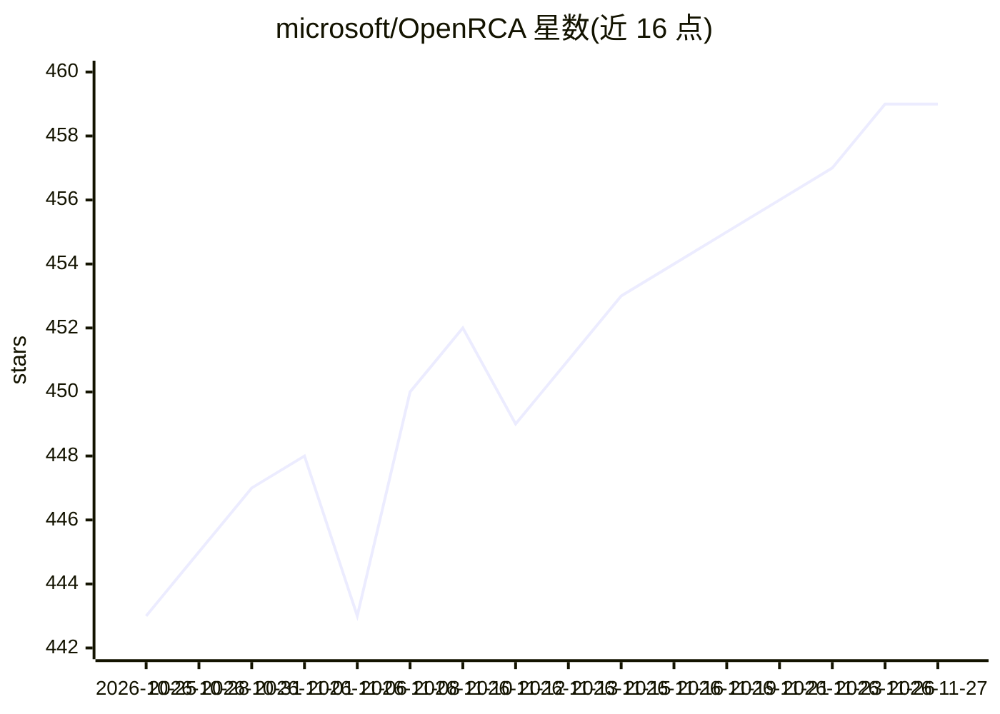

# microsoft/OpenRCA

⭐ 459 · Python · MIT · 推送 2026-11-04 · [GitHub](https://github.com/microsoft/OpenRCA) · [官网](https://aka.ms/openrca) · 组织维护

**评测 LLM 软件故障根因分析能力的基准及基线 agent**

OpenRCA 是面向软件运维场景的基准：给定自然语言查询，模型需分析 KPI 时间序列、依赖调用链图和半结构化日志等大规模遥测数据，定位根因组件。附带 RCA-agent 基线，通过生成 Python 代码在沙箱容器中检索与分析数据，避免超长上下文。数据集含 Telecom/Bank/Market 三套系统，遥测数据从 Google Drive 下载；支持自定义任务生成与自研 agent 提交评测。运行需 Python≥3.10，RCA-agent 需本地 Docker 引擎，官方建议至少 80GB 存储与 32GB 内存。

## 筛选速览

| 维度 | 判定 | 备注 |
|---|---|---|
| AI 角色 | `ai-knowledge` | 知识聚合/清单类 |
| 许可风险 | `permissive` | MIT |
| 部署形态 | `self-host` | docker 或自建部署 |
| 模型依赖 | — | README 未给出锁定关系 |
| 硬件要求 | — | 无带数字的原话,不猜 |
| 安装摩擦 | `low` | 无编译、无系统依赖或容器化 |
| 成熟度 | — | 结构信号不足 |

## 能力要点

- 覆盖 KPI 时间序列、trace 图、日志三类遥测数据的根因定位任务
- RCA-agent 基线以 Python 代码执行方式处理大规模遥测
- 无网络、只读挂载、资源限额的沙箱执行环境
- 支持用自有遥测数据生成新任务

## 适用场景

- 评测自研 LLM 在运维根因分析上的表现
- 复现论文中 RCA-agent 的结果
- 用私有遥测数据构建自定义根因定位任务

## 场景标签

`模型评测` · 领域:评测与运维

## 证据(README 行号)

> L7: OpenRCA is a benchmark for assessing LLMs' root cause analysis ability in a software operating scenario. When given 
> L9: We also introduce RCA-agent as a baseline for OpenRCA. By using Python for data retrieval and analysis, the model av
> L13: > ⚠️ Since the OpenRCA dataset includes a large amount of telemetry and RCA-agent requires extensive memory operati

## 星数曲线

2026-10-25 443 → 2026-11-27 459（+16）

---
*卡片 v1 · prompt 1.4 · 生成 2026-11-25 · 置信度 high · 依据 README sha `4507ad192e06` · [字段定义](../../DATASET.md)*
