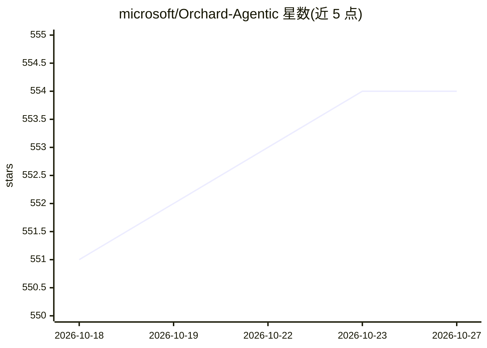

# microsoft/Orchard-Agentic

⭐ 554 · Python · MIT · 推送 2026-10-09 · [GitHub](https://github.com/microsoft/Orchard-Agentic) · [官网](https://microsoft.github.io/Orchard-Agentic/) · 组织维护

**开源智能体建模研究集合：沙箱环境服务+评测+RL训练配方**

微软发布的智能体建模开源工作集合，包含基础论文 Orchard 及 OpenWebRL、OpenForge RL 等后续项目。核心组件 Orchard Env 是 Kubernetes 原生沙箱服务，按需创建隔离容器并支持多轮 agent 与沙箱交互（exec、文件 I/O、git patch），附带 Python SDK 与 REST API；Orchard Eval 在该环境上运行多种 agent harness 对 SWE-bench Verified 评测；Trainer 为 slime fork 的 RL 训练栈，提供 SWE/GUI/Claw 三套训练配方。训练器节点需 GPU（如 8×B200），沙箱环境仅 CPU 即可运行；面向智能体训练与评测研究者。

## 筛选速览

| 维度 | 判定 | 备注 |
|---|---|---|
| AI 角色 | `ai-ecosystem` | LLM/agent 周边工具 |
| 许可风险 | `permissive` | MIT |
| 部署形态 | `library` | 以包/库形式分发 |
| 模型依赖 | — | README 未给出锁定关系 |
| 硬件要求 | `cpu-ok` | |
| 安装摩擦 | `low` | 无编译、无系统依赖或容器化 |
| 成熟度 | — | 结构信号不足 |

## 能力要点

- Orchard Env：K8s 原生沙箱服务，REST API + 同步/异步 Python SDK，任意基础镜像与任意 harness
- 沙箱内预装 codex/claude/pi/opencode/hermes 等 harness，切换 harness 仅改命令
- Orchard Eval 按任务一沙箱跑 SWE-bench Verified，官方 harness 评分、运行可恢复
- 提供 107K SWE 轨迹与 3,070 条多模态浏览器导航数据集（Hugging Face）

## 适用场景

- 做智能体 RL 训练研究，需要可复用的沙箱环境与训练配方
- 在统一环境上对不同 agent harness 做 SWE-bench 评测
- 复用或扩展轨迹蒸馏数据集与训练配方做后续研究

## 场景标签

`模型评测` `强化学习` · 领域:评测与运维

## 证据(README 行号)

> L29: |**Orchard Env** (`orchard_env/`)|The foundation. A Kubernetes-native sandbox service + Python SDK that spins up th
> L30: |**Orchard Eval** (`orchard_eval/`)|Evaluation. Runs any agent harness — `codex`, `pi`, `mini-swe-agent`, … — again
> L31: |**Trainer** (`trainer/slime/`)|RL training stack — a slime fork vendored as a git submodule (MSR-Orchard/slime), w

## 星数曲线

2026-10-18 551 → 2026-10-27 554（+3）

---
*卡片 v1 · prompt 1.4 · 生成 2026-10-21 · 置信度 high · 依据 README sha `79b60f422f4e` · [字段定义](../../DATASET.md)*
