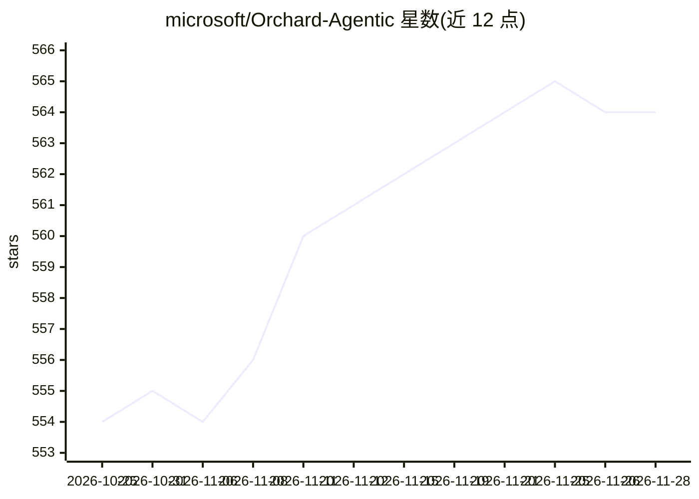

# microsoft/Orchard-Agentic

⭐ 564 · Python · MIT · 推送 2026-11-07 · [GitHub](https://github.com/microsoft/Orchard-Agentic) · [官网](https://microsoft.github.io/Orchard-Agentic/) · 组织维护

**微软的 agentic 建模开源研究项目集合与环境服务**

微软发布的 agentic 建模研究集合：以 Orchard Env（Kubernetes 原生沙箱服务 + Python SDK）为基础层，按需启动数千个隔离容器并通过 HTTP 驱动多轮 agent 与沙箱交互；配套 Orchard Eval（用官方 SWE-bench 评测多种 agent harness）、slime RL 训练栈及多个子项目代码与 Hugging Face 数据集（107K SWE 轨迹、3,070 条浏览器多模态轨迹）。采用 MIT 许可，面向从事 agent 训练与评测研究的团队。

## 筛选速览

| 维度 | 判定 | 备注 |
|---|---|---|
| AI 角色 | `ai-knowledge` | 知识聚合/清单类 |
| 许可风险 | `permissive` | MIT |
| 部署形态 | `library` | 以包/库形式分发 |
| 模型依赖 | — | README 未给出锁定关系 |
| 硬件要求 | — | 无带数字的原话,不猜 |
| 安装摩擦 | `low` | 无编译、无系统依赖或容器化 |
| 成熟度 | — | 结构信号不足 |

## 能力要点

- Orchard Env 提供 Kubernetes 原生沙箱服务与同步/异步 Python SDK
- 沙箱预装 codex/claude/pi/opencode/hermes 等 agent harness 到 PATH
- Orchard Eval 可在沙箱上运行多种 harness 并按官方 SWE-bench 评分
- 附 Hugging Face 研究数据集与多个子项目（WildAWM、Self-HPO、OpenWebRL 等）

## 适用场景

- 为 agent RL 训练批量提供隔离的可验证环境沙箱
- 在统一环境上对多种 agent harness 做标准化评测
- 获取 SWE 与浏览器导航轨迹数据集用于训练复现

## 场景标签

`模型评测` `强化学习` · 领域:评测与运维

## 证据(README 行号)

> L8: **Orchard-Agentic is a collection of open-source work on agentic modeling.**
> L9: It brings together research projects, shared infrastructure, datasets, training
> L31: |**Orchard Env** (`orchard_env/`)|The foundation. A Kubernetes-native sandbox service + Python SDK that spins up th

## 星数曲线

2026-10-25 554 → 2026-11-28 564（+10）

---
*卡片 v1 · prompt 1.4 · 生成 2026-11-25 · 置信度 mid · 依据 README sha `ce51a77bf916` · [字段定义](../../DATASET.md)*
