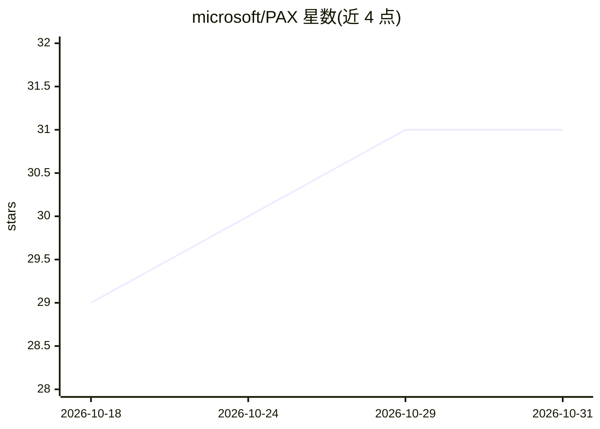

# microsoft/PAX

⭐ 31 · PowerShell · MIT · 推送 2026-10-23 · [GitHub](https://github.com/microsoft/PAX) · [官网](https://aka.ms/PAXapp) · 组织维护

**企业工具集：导出 M365 Copilot 审计日志为分析就绪数据**

微软官方维护的审计日志导出方案集：通过 Microsoft Graph API 从 Microsoft Purview 统一审计日志、Entra ID 与 M365 管理中心拉取 Copilot、AI agent 及生产力工作负载（Teams/SharePoint/Excel 等）使用数据，输出为 CSV 或直接写入 Microsoft Fabric (OneLake) Delta 表，供 Power BI 模板分析。提供 PowerShell 脚本引擎、Windows 图形应用 PAX Cookbook（标注即将发布）与浏览器端命令行生成器 Mini-Kitchen 三种使用方式，支持断点续传、并行处理与按用户/活动类型过滤。README 明确警告导出数据含 PII 且不做脱敏，合规责任由客户承担。

## 筛选速览

| 维度 | 判定 | 备注 |
|---|---|---|
| AI 角色 | `ai-ecosystem` | LLM/agent 周边工具 |
| 许可风险 | `permissive` | MIT |
| 部署形态 | `None` |  |
| 模型依赖 | — | README 未给出锁定关系 |
| 硬件要求 | — | 无带数字的原话,不猜 |
| 安装摩擦 | `low` | 无编译、无系统依赖或容器化 |
| 成熟度 | `idea` | |

## 能力要点

- 从 Purview 统一审计日志导出 Copilot 与 AI agent 使用信号至 CSV 或 Fabric Delta 表
- 同一运行内捕获 11 种生产力工作负载活动并做 Entra ID 用户与许可信息富化
- 企业级长导出：断点续传、并行处理、自适应时间切片
- 三个专用脚本：Purview 处理器、Copilot 交互内容处理器、Graph 轻量导出器

## 适用场景

- 企业分析 Microsoft 365 Copilot 与 AI agent 的使用情况与 ROI
- 将审计日志落地 Power BI 仪表盘（AI-in-One 等）
- 审计 Copilot 提示/响应内容（专用脚本）

## 场景标签

 · 领域:企业 IT 审计/M365 分析

## 证据(README 行号)

> L21: **Portable Audit eXporter (PAX)** is a solution set for exporting Microsoft 365 Copilot, AI agent, and broader work
> L43: Under the hood, every Cookbook bake runs the same **PAX engine**: a set of enterprise-grade PowerShell scripts you 

## 星数曲线

2026-10-18 29 → 2026-10-31 31（+2）

---
*卡片 v1 · prompt 1.4 · 生成 2026-10-26 · 置信度 high · 依据 README sha `c4e75e725195` · [字段定义](../../DATASET.md)*
