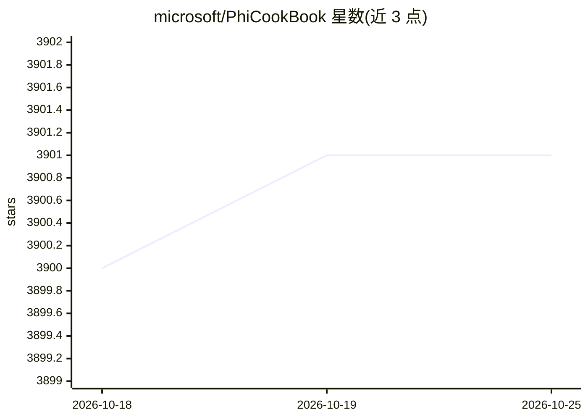

# microsoft/PhiCookBook

⭐ 3,902 · Jupyter Notebook · MIT · 推送 2026-10-21 · [GitHub](https://github.com/microsoft/PhiCookBook) · 组织维护

**微软 Phi 系列小语言模型的上手示例与教程合集**

微软官方维护的 Phi 系列 SLM 实操教程仓库（Cookbook），覆盖 Phi-3/Phi-4 及 mini/multimodal 等变体的使用示例。内容包括在 Microsoft Foundry、GitHub Model Catalog、Hugging Face 上体验和定制 Phi 模型，构建云端或边缘设备上的生成式 AI 应用，并提供 Codespaces 与 Dev Containers 两种开发环境。仓库含 50+ 种语言翻译，可经 sparse checkout 跳过翻译目录以减小下载量；另附负责任 AI 与 Azure AI 评估 SDK 的指引。以 git clone 方式获取，无桌面构建物。

## 筛选速览

| 维度 | 判定 | 备注 |
|---|---|---|
| AI 角色 | `ai-knowledge` | 知识聚合/清单类 |
| 许可风险 | `permissive` | MIT |
| 部署形态 | `None` |  |
| 模型依赖 | — | README 未给出锁定关系 |
| 硬件要求 | — | 无带数字的原话,不猜 |
| 安装摩擦 | `low` | 无编译、无系统依赖或容器化 |
| 成熟度 | — | 结构信号不足 |

## 能力要点

- 覆盖 Phi-3/Phi-4 系列模型的使用与 E2E 解决方案示例
- 支持 GitHub Codespaces 与 Dev Containers 开发环境
- 50+ 语言翻译，可用 sparse checkout 跳过以加速克隆
- 演示在 Microsoft Foundry / GitHub Models / Hugging Face 三个渠道使用 Phi

## 适用场景

- 跟着示例学习微软 Phi 系列小语言模型的用法
- 查找云端或边缘设备上部署 Phi 构建 AI 应用的方案
- 在 Codespaces 或 Dev Containers 中直接运行示例环境

## 场景标签

`教程课程` · 领域:学习与行业

## 证据(README 行号)

> L1: # Phi Cookbook: Hands-On Examples with Microsoft's Phi Models
> L17: Phi is a series of open source AI models developed by Microsoft.
> L25: 2. **Clone the Repository**: `git clone https://github.com/microsoft/PhiCookBook.git`

## 星数曲线

2026-10-18 3,900 → 2026-10-25 3,901（+1）

---
*卡片 v1 · prompt 1.4 · 生成 2026-10-20 · 置信度 high · 依据 README sha `3094906000dd` · [字段定义](../../DATASET.md)*
