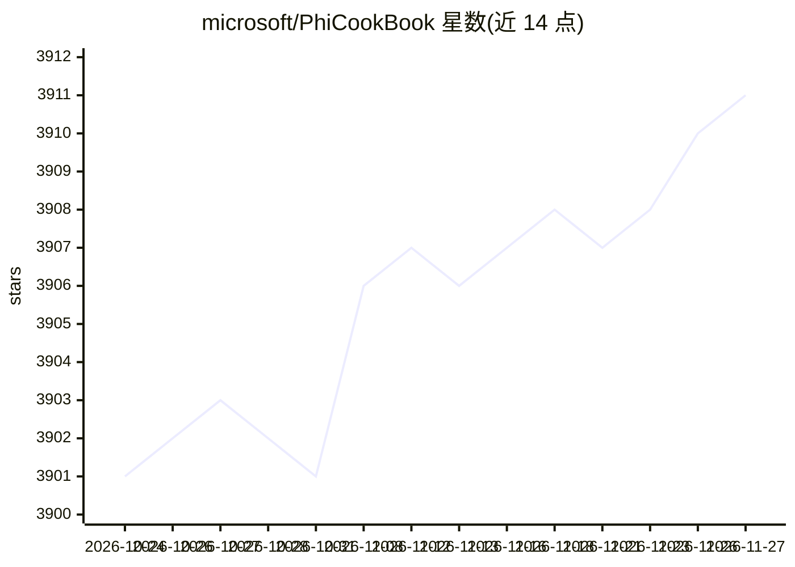

# microsoft/PhiCookBook

⭐ 3,911 · Jupyter Notebook · MIT · 推送 2026-11-16 · [GitHub](https://github.com/microsoft/PhiCookBook) · 组织维护

**微软 Phi 系列小模型的上手示例教程集**

微软官方维护的 Phi 系列开源小语言模型（SLM）教程仓库，提供在云与边缘设备上使用和部署 Phi 模型的示例与入门路径，覆盖文本/聊天生成、代码、图像、音频等场景。仓库含 50+ 语言翻译（可用 sparse-checkout 加速克隆），介绍 Microsoft Foundry 模型目录、Azure AI Playground 与 Hugging Face/Hugging Chat 体验入口，并附负责任 AI 内容与微软其他系列课程索引。

## 筛选速览

| 维度 | 判定 | 备注 |
|---|---|---|
| AI 角色 | `ai-knowledge` | 知识聚合/清单类 |
| 许可风险 | `permissive` | MIT |
| 部署形态 | `None` |  |
| 模型依赖 | — | README 未给出锁定关系 |
| 硬件要求 | — | 无带数字的原话,不猜 |
| 安装摩擦 | `low` | 无编译、无系统依赖或容器化 |
| 成熟度 | — | 结构信号不足 |

## 能力要点

- Phi 模型在云与边缘设备上部署的示例集合
- 支持 GitHub Codespaces / Dev Containers 直接打开使用
- 50+ 语言翻译，提供 sparse-checkout 快速克隆方式
- 提供 Microsoft Foundry、Azure AI Playground、Hugging Face 多个体验入口

## 适用场景

- 入门使用微软 Phi 系列小语言模型
- 在有限算力设备上构建生成式 AI 应用的参考
- 查找 Phi 模型在云/边缘不同硬件上的部署示例

## 场景标签

`教程课程` · 领域:学习与行业

## 证据(README 行号)

> L1: # Phi Cookbook: Hands-On Examples with Microsoft's Phi Models
> L23: Follow these steps to get started using these resource :
> L62: You can learn how to use Microsoft Phi and how to build E2E solutions in your different hardware devices. To experi

## 星数曲线

2026-10-24 3,901 → 2026-11-27 3,911（+10）

---
*卡片 v1 · prompt 1.4 · 生成 2026-11-23 · 置信度 high · 依据 README sha `46cfc6ff7125` · [字段定义](../../DATASET.md)*
