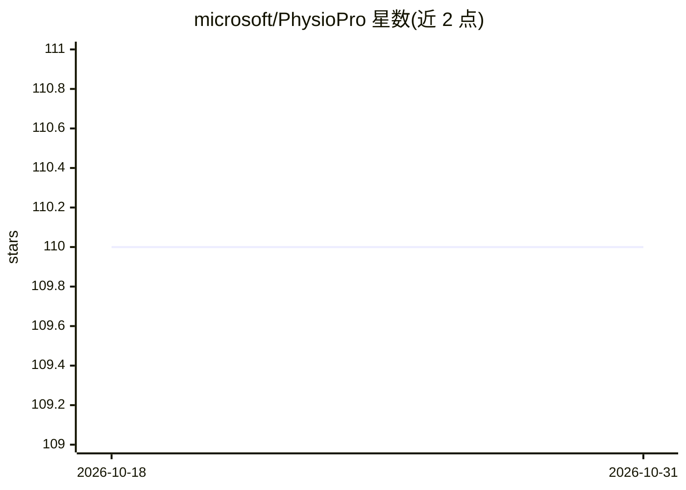

# microsoft/PhysioPro

⭐ 110 · Python · MIT · 推送 2026-07-17 · [GitHub](https://github.com/microsoft/PhysioPro) · 组织维护

**微软的生理信号深度学习处理与理解框架**

面向时间序列生理数据（如 EEG）研究的深度学习框架，收录关联论文的模型实现（如拓扑无关 EEG 表征学习、ContiFormer 连续时间 Transformer），并提供其中一项的预训练 checkpoint。以源码方式安装（pip install .），不随附数据或训练模型，需用户自带数据训练。声明不得用于临床场景影响治疗决策，且未做 Responsible AI 公平性测试。

## 筛选速览

| 维度 | 判定 | 备注 |
|---|---|---|
| AI 角色 | `ai-native` | 本体是模型或模型工具 |
| 许可风险 | `permissive` | MIT |
| 部署形态 | `library` | 以包/库形式分发 |
| 模型依赖 | — | README 未给出锁定关系 |
| 硬件要求 | — | 无带数字的原话,不猜 |
| 安装摩擦 | `low` | 无编译、无系统依赖或容器化 |
| 成熟度 | — | 结构信号不足 |

## 能力要点

- 生理时间序列数据的深度学习建模框架
- 提供论文配套模型实现与预训练 checkpoint
- 支持源码安装与开发模式安装

## 适用场景

- 用自有 EEG 等生理数据训练深度学习模型
- 复现拓扑无关 EEG 表征学习等论文方法
- 开展生理信号时间序列建模研究

## 场景标签

`模型训练` · 领域:训练与推理

## 证据(README 行号)

> L1: A deep learning framework for physiological data processing and understanding.
> L31: Our goal in publishing this code is to facilitate AI research on time-series data, especially in the field of physi

## 星数曲线

2026-10-18 110 → 2026-10-31 110（+0）

---
*卡片 v1 · prompt 1.4 · 生成 2026-10-23 · 置信度 high · 依据 README sha `9d4eb4b3d28b` · [字段定义](../../DATASET.md)*
