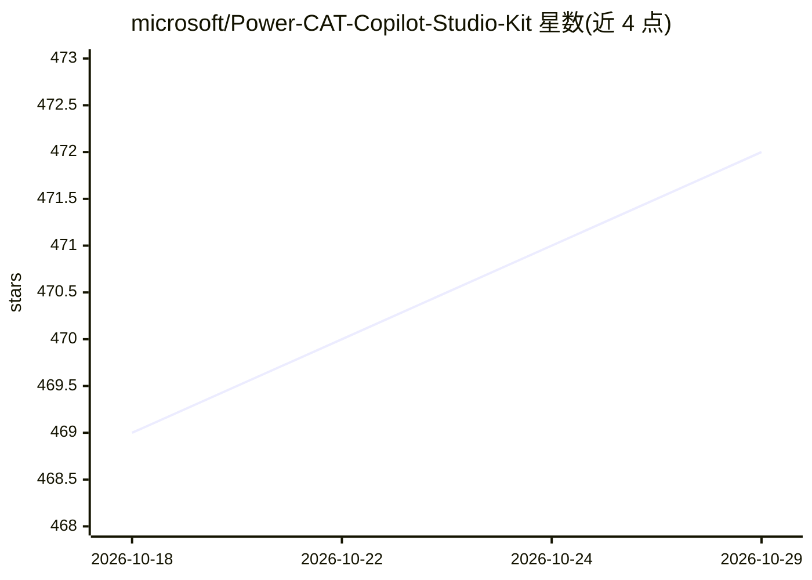

# microsoft/Power-CAT-Copilot-Studio-Kit

⭐ 472 · TypeScript · MIT · 推送 2026-10-27 · [GitHub](https://github.com/microsoft/Power-CAT-Copilot-Studio-Kit) · [官网](https://microsoft.github.io/Power-CAT-Copilot-Studio-Kit/) · 组织维护

**扩展 Microsoft Copilot Studio 的 agent 开发/测试/治理工具包**

面向在 Power Platform 上构建自定义 agent 的制作者与管理员：提供批量测试（响应匹配、多轮、生成式答案，支持用户自定义评分标准）、Compliance Hub 合规治理与 SLA 案例、Agent Insights Hub 分析面板（聚合 Application Insights 遥测与对话转录）、Agent Debugger 决策诊断、变更跟踪、Agent Library 模板库、Prompt Advisor、Conversation KPI 等。经 Microsoft Marketplace 或 GitHub 部署，需要 Power Platform 许可与 AI Builder 额度；测试自动化中终端用户认证仅支持 Entra ID V2 与 SSO。

## 筛选速览

| 维度 | 判定 | 备注 |
|---|---|---|
| AI 角色 | `ai-ecosystem` | LLM/agent 周边工具 |
| 许可风险 | `permissive` | MIT |
| 部署形态 | `None` |  |
| 模型依赖 | — | README 未给出锁定关系 |
| 硬件要求 | — | 无带数字的原话,不猜 |
| 安装摩擦 | `medium` | 含编译或系统依赖之一 |
| 成熟度 | — | 结构信号不足 |

## 能力要点

- 批量测试自定义 agent，含延迟、响应与聚合结果，支持用户自定义 rubrics
- Compliance Hub 按风险阈值自动生成合规案例并跟踪 SLA 审查流程
- Agent Insights Hub 聚合 Application Insights 遥测与对话转录，支持 365 天历史同步与 Excel 导出
- Agent Debugger 按步骤检查 agent 决策（计时、token 用量、知识源、参数）

## 适用场景

- 批量测试 Copilot Studio 自定义 agent 并分析测试结果
- 组织内对 agent 配置做规模化治理与合规审查
- 监控 agent 性能、对话指标与额度消耗
- 通过 Power Platform Pipelines 在部署前自动验证 agent

## 场景标签

`模型评测` `LLM 可观测性` · 领域:评测与运维

## 证据(README 行号)

> L3: The **Copilot Agent Kit** is a comprehensive set of capabilities designed to augment Microsoft Copilot Studio. The k
> L9: Copilot Agent Kit allows makers to configure agents, tests and test sets, and use them to batch test their custom ag

## 星数曲线

2026-10-18 469 → 2026-10-29 472（+3）

---
*卡片 v1 · prompt 1.4 · 生成 2026-10-21 · 置信度 high · 依据 README sha `b605b4e53427` · [字段定义](../../DATASET.md)*
