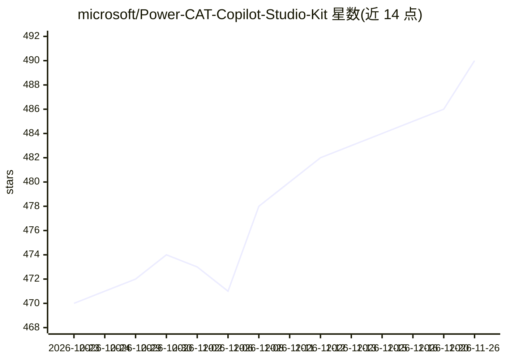

# microsoft/Power-CAT-Copilot-Studio-Kit

⭐ 490 · TypeScript · MIT · 推送 2026-11-25 · [GitHub](https://github.com/microsoft/Power-CAT-Copilot-Studio-Kit) · [官网](https://microsoft.github.io/Power-CAT-Copilot-Studio-Kit/) · 组织维护

**为 Copilot Studio 制作者提供代理开发、治理与测试的工具集**

围绕 Microsoft Copilot Studio 的托管解决方案集合，包含批量测试（响应/附件/话题匹配、多轮、生成式答案）、模型评估对比、合规中心、遥测分析仪表盘、代理调试器、变更跟踪、模板与组件库、提示词顾问、聊天界面定制及 KPI 汇总等模块。面向企业中的 maker 与管理员，通过 Setup Wizard 配置连接引用和环境变量后部署，依赖 Power Platform 许可与 AI Builder 额度；测试自动化的最终用户认证仅支持 Entra Id V2 with SSO。

## 筛选速览

| 维度 | 判定 | 备注 |
|---|---|---|
| AI 角色 | `ai-ecosystem` | LLM/agent 周边工具 |
| 许可风险 | `permissive` | MIT |
| 部署形态 | `None` |  |
| 模型依赖 | — | README 未给出锁定关系 |
| 硬件要求 | — | 无带数字的原话,不猜 |
| 安装摩擦 | `medium` | 含编译或系统依赖之一 |
| 成熟度 | — | 结构信号不足 |

## 能力要点

- 批量测试自定义代理并输出延迟、响应与聚合结果
- Model Assessment 对比新旧模型并给出回归状态
- Compliance Hub 按风险阈值自动创建合规案件并跟踪 SLA
- Agent Insights Hub 聚合 Application Insights 与对话记录遥测

## 适用场景

- 在企业内集中治理和审计组织内所有 Copilot Studio 代理
- 部署前对代理做批量回归测试作为质量门禁
- 切换底层 AI 模型前评估代理行为是否退化
- 统一仪表盘监控代理性能、错误与额度消耗

## 场景标签

`模型评测` `LLM 可观测性` · 领域:评测与运维

## 证据(README 行号)

> L3: The **Copilot Agent Kit** is a comprehensive set of capabilities designed to augment Microsoft Copilot Studio. The k
> L122: There is a Setup Wizard in the Kit which allows easy editing of connection references and environment variables as

## 星数曲线

2026-10-23 470 → 2026-11-26 490（+20）

---
*卡片 v1 · prompt 1.4 · 生成 2026-11-25 · 置信度 high · 依据 README sha `b14cc66ca060` · [字段定义](../../DATASET.md)*
