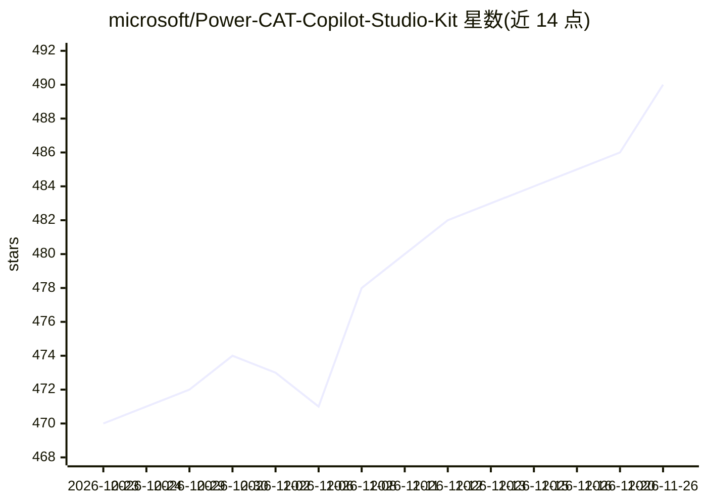

# microsoft/Power-CAT-Copilot-Studio-Kit

⭐ 490 · TypeScript · MIT · 推送 2026-11-25 · [GitHub](https://github.com/microsoft/Power-CAT-Copilot-Studio-Kit) · [官网](https://microsoft.github.io/Power-CAT-Copilot-Studio-Kit/) · 组织维护

**给 Copilot Studio 制作者提供 agent 开发、治理与测试的工具套件**

围绕 Microsoft Copilot Studio 的能力套件，以托管解决方案形式部署到 Power Platform，包含多个应用与流程：批量测试与测试集管理（响应/附件/话题匹配、多轮、生成式答案评分）、换模型前的回归评估（Healthy/Warning/Critical 状态与 AI 建议）、合规治理（Agent Inventory 采集配置、按风险阈值建案并走 SLA 审核）、遥测分析仪表盘、逐步调试器、变更追踪、模板与组件库、Prompt 分析建议、KPI 汇总及 DLP 连接器审批流程。依赖 Power Platform 许可与 AI Builder 额度。

## 筛选速览

| 维度 | 判定 | 备注 |
|---|---|---|
| AI 角色 | `ai-ecosystem` | LLM/agent 周边工具 |
| 许可风险 | `permissive` | MIT |
| 部署形态 | `None` |  |
| 模型依赖 | — | README 未给出锁定关系 |
| 硬件要求 | — | 无带数字的原话,不猜 |
| 安装摩擦 | `medium` | 含编译或系统依赖之一 |
| 成熟度 | — | 结构信号不足 |

## 能力要点

- 批量测试 agent 并输出延迟、响应与聚合结果，支持自定义评分 rubric
- Model Assessment 对比新旧模型运行并给出回归状态与 AI 推荐
- Compliance Hub 按风险阈值自动创建合规案件并跟踪处理
- Agent Insights Hub 聚合 Application Insights 与对话转录的分析仪表盘

## 适用场景

- 上线前对自定义 agent 做批量回归测试
- 企业统一治理与审计组织内所有 Copilot Studio agent
- 分析 agent 会话表现与额度消耗并导出报表
- 通过部署流水线把测试作为上线质量门禁

## 场景标签

`模型评测` `LLM 可观测性` · 领域:评测与运维

## 证据(README 行号)

> L3: The **Copilot Agent Kit** is a comprehensive set of capabilities designed to augment Microsoft Copilot Studio. The k
> L23: Compliance Hub helps organizations define and enforce governance policies for Copilot Studio agents at scale. It co

## 星数曲线

2026-10-23 470 → 2026-11-26 490（+20）

---
*卡片 v1 · prompt 1.4 · 生成 2026-11-26 · 置信度 high · 依据 README sha `d5785a0c50cc` · [字段定义](../../DATASET.md)*
