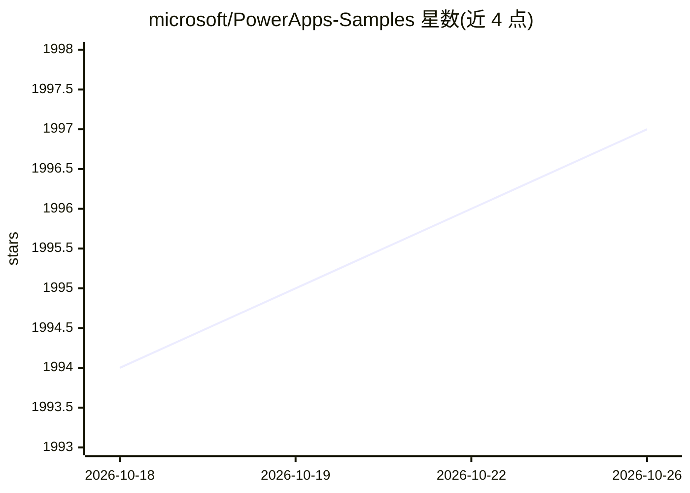

# microsoft/PowerApps-Samples

⭐ 1,997 · C# · MIT · 推送 2026-10-13 · [GitHub](https://github.com/microsoft/PowerApps-Samples) · [官网](https://docs.microsoft.com/powerapps) · 组织维护

**微软官方 Power Apps 平台示例代码集合，覆盖 Dataverse/PCF/AI Builder 等**

微软维护的 Power Apps 官方示例代码仓库，按平台能力组织：Dataverse、模型驱动应用、画布应用、Power Apps component framework、portals（Power Pages）以及 AI Builder 各提供示例代码，README 附各模块开发者文档入口。面向在 Power Platform / Dynamics 365 上做开发的人员，作为参考实现使用；本仓库不提供可独立运行的 AI 模型，仅是面向微软低代码平台的示例聚合。

## 筛选速览

| 维度 | 判定 | 备注 |
|---|---|---|
| AI 角色 | `ai-knowledge` | 知识聚合/清单类 |
| 许可风险 | `permissive` | MIT |
| 部署形态 | `None` |  |
| 模型依赖 | — | README 未给出锁定关系 |
| 硬件要求 | — | 无带数字的原话,不猜 |
| 安装摩擦 | `low` | 无编译、无系统依赖或容器化 |
| 成熟度 | — | 结构信号不足 |

## 能力要点

- 覆盖 Dataverse、模型驱动应用、画布应用等 6 类 Power Apps 示例
- 含 Power Apps component framework（PCF）控件示例
- 含 AI Builder 相关示例代码
- README 链接各模块官方开发者文档

## 适用场景

- 开发 Power Platform/Dynamics 365 应用时查找参考示例代码
- 学习 Dataverse 或 PCF 控件开发
- 了解 AI Builder 的代码集成方式

## 场景标签

 · 领域:低代码/企业应用开发

## 证据(README 行号)

> L1: # Power Apps Samples
> L3: Welcome to the samples repo for Power Apps. The repo contains sample code for Power Apps, including Dataverse, model

## 星数曲线

2026-10-18 1,994 → 2026-10-26 1,997（+3）

---
*卡片 v1 · prompt 1.4 · 生成 2026-10-21 · 置信度 high · 依据 README sha `9e9a314424ed` · [字段定义](../../DATASET.md)*
