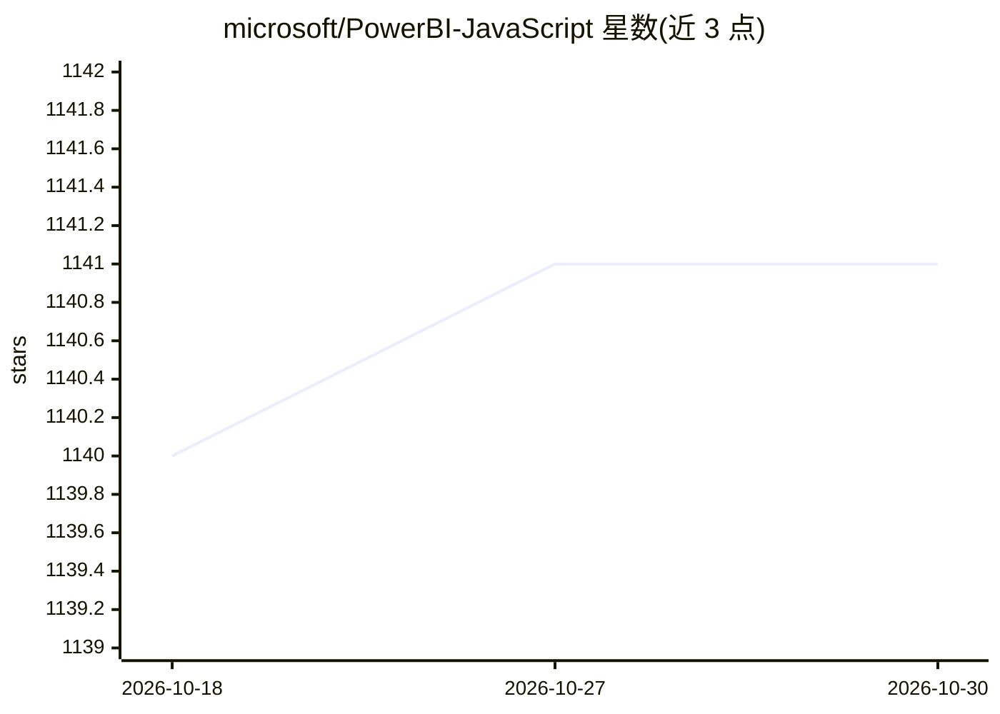

# microsoft/PowerBI-JavaScript

⭐ 1,141 · TypeScript · NOASSERTION · 推送 2026-10-07 · [GitHub](https://github.com/microsoft/PowerBI-JavaScript) · 组织维护

**将 Power BI 报表嵌入 Web 应用的 JavaScript/TypeScript 客户端库**

微软维护的客户端库，供开发者在自有应用中嵌入 Power BI 报表并与嵌入式分析客户端 API 交互。以 npm 包 powerbi-client 与 Nuget 包 Microsoft.PowerBI.JavaScript 分发，支持 ES6 模块导入或以 UMD 脚本方式直接引入并暴露全局 powerbi。提供官方文档、代码文档、示例仓库与在线 Playground。本库本体为报表嵌入 SDK，README 未声明 AI 功能。

## 筛选速览

| 维度 | 判定 | 备注 |
|---|---|---|
| AI 角色 | `ai-enhanced` | 去掉 AI 部分产品仍成立 |
| 许可风险 | `none` | NOASSERTION |
| 部署形态 | `library` | 以包/库形式分发 |
| 模型依赖 | — | README 未给出锁定关系 |
| 硬件要求 | — | 无带数字的原话,不猜 |
| 安装摩擦 | `low` | 无编译、无系统依赖或容器化 |
| 成熟度 | — | 结构信号不足 |

## 能力要点

- 在 JavaScript/TypeScript 应用中嵌入 Power BI 报表
- 同时以 npm 与 Nuget 分发，支持 beta 版本安装
- 支持 ES6 模块导入与 UMD 全局引入两种方式
- 提供官方示例仓库与在线 Playground

## 适用场景

- 在自家 Web 应用中嵌入 Power BI 报表与仪表板
- 通过客户端 API 操作已嵌入的报表
- 试用嵌入式分析能力（Playground）

## 场景标签

 · 领域:商业智能/数据可视化

## 证据(README 行号)

> L2: A client side library for embedding Power BI using JavaScript or TypeScript into your apps.
> L13: See the Power BI embedded analytics Client APIs documentation to learn how to embed a Power BI report in your appli

## 星数曲线

2026-10-18 1,140 → 2026-10-30 1,141（+1）

---
*卡片 v1 · prompt 1.4 · 生成 2026-10-21 · 置信度 mid · 依据 README sha `bfd3707c627a` · [字段定义](../../DATASET.md)*
