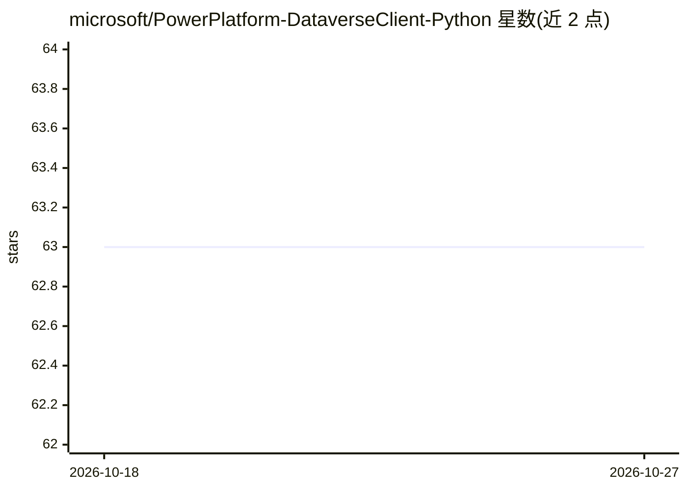

# microsoft/PowerPlatform-DataverseClient-Python

⭐ 63 · Python · MIT · 推送 2026-10-12 · [GitHub](https://github.com/microsoft/PowerPlatform-DataverseClient-Python) · 组织维护

**微软 Dataverse 官方 Python SDK：以 Python 访问与操作业务数据**

微软官方的 Dataverse Python SDK，封装 Dataverse Web API 为单一类型化客户端，供 Python 开发者在不掌握 .NET 的情况下对 Dataverse 业务数据、元数据与平台能力进行 CRUD、批量操作、文件上传与事务批处理。记录以原生字典与 pandas DataFrame 读写，查询提供类型安全的 QueryBuilder 并支持 SQL 与 FetchXML。认证采用 Azure Identity 的任意 TokenCredential，另有镜像同步 API 的异步客户端。README 提及可用于应用、自动化及 AI agent 接入场景。

## 筛选速览

| 维度 | 判定 | 备注 |
|---|---|---|
| AI 角色 | `ai-ecosystem` | LLM/agent 周边工具 |
| 许可风险 | `permissive` | MIT |
| 部署形态 | `library` | 以包/库形式分发 |
| 模型依赖 | — | README 未给出锁定关系 |
| 硬件要求 | — | 无带数字的原话,不猜 |
| 安装摩擦 | `low` | 无编译、无系统依赖或容器化 |
| 成熟度 | — | 结构信号不足 |

## 能力要点

- 封装 Dataverse Web API 的单一类型化客户端，记录以字典与 pandas DataFrame 读写
- 原生 CreateMultiple/UpdateMultiple/UpsertMultiple/BulkDelete 批量操作
- 类型安全 QueryBuilder，另支持只读 SQL 与 FetchXML 查询
- Azure Identity 任意 TokenCredential 认证与异步客户端（[async] extra）

## 适用场景

- 用 Python 读写和管理 Dataverse 业务数据与表结构
- 将 pandas DataFrame 批量写入或读出 Dataverse
- 为自动化或 AI agent 提供对 Dataverse 数据的编程访问

## 场景标签

 · 领域:企业数据平台/微软 Power Platform

## 证据(README 行号)

> L7: The Dataverse SDK for Python lets Python developers access, manage, and manipulate Microsoft Dataverse business data
> L21: - **Azure Identity auth & typed errors** — any `TokenCredential`; structured exception hierarchy with retry guidanc

## 星数曲线

2026-10-18 63 → 2026-10-27 63（+0）

---
*卡片 v1 · prompt 1.4 · 生成 2026-10-24 · 置信度 mid · 依据 README sha `0a43f20cfe20` · [字段定义](../../DATASET.md)*
