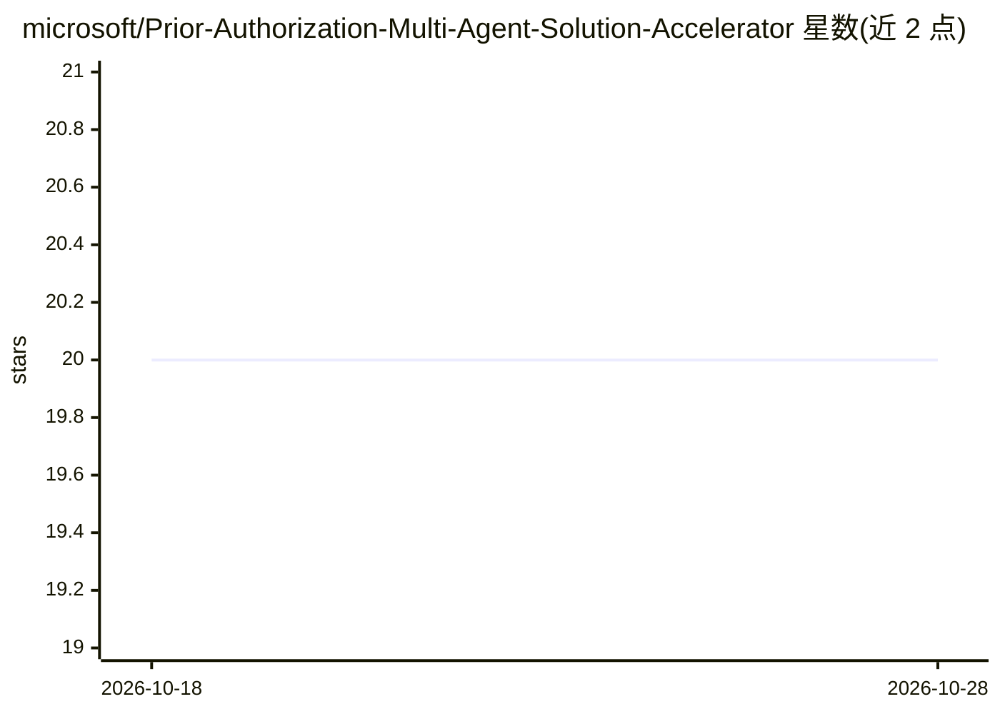

# microsoft/Prior-Authorization-Multi-Agent-Solution-Accelerator

⭐ 20 · Python · MIT · 推送 2026-08-11 · [GitHub](https://github.com/microsoft/Prior-Authorization-Multi-Agent-Solution-Accelerator) · 组织维护

**面向医保支付方的 AI 预授权审查多智能体方案加速器**

微软出品的解决方案加速器：四个专用 Agent（合规、临床审查、覆盖范围、综合）基于 Microsoft Agent Framework 与 Azure OpenAI GPT-5.4，按三道关卡（Provider→Codes→Medical Necessity）对预授权请求进行 MET/NOT_MET/INSUFFICIENT 逐项评分与置信度加权，产出可审计的批准/待定建议，单例审查 2 分钟内完成。通过五个 Anthropic 医疗 MCP 数据服务器获取 NPI、ICD-10、CMS 覆盖政策等数据；AI 建议仅为草稿，需临床医生接受或推翻并记录理由。支持 azd up 部署 Azure 或 Docker Compose 本地运行；覆盖政策仅反映 Medicare LCD/NCD。

## 筛选速览

| 维度 | 判定 | 备注 |
|---|---|---|
| AI 角色 | `ai-native` | 本体是模型或模型工具 |
| 许可风险 | `permissive` | MIT |
| 部署形态 | `self-host` | docker 或自建部署 |
| 模型依赖 | locked-api |  |
| 硬件要求 | — | 无带数字的原话,不猜 |
| 安装摩擦 | `low` | 无编译、无系统依赖或容器化 |
| 成熟度 | `idea` | |

## 能力要点

- 四 Agent 并行执行（asyncio.gather），单例审查从 20+ 分钟降至 2 分钟内
- 三道顺序关卡的决策规则与逐条目置信度评分、审计留痕（Markdown+PDF）
- 五个 Anthropic 医疗 MCP 数据服务器（NPI/ICD-10/CMS 覆盖/临床试验/PubMed）
- SKILL.md 定义 Agent 行为，领域专家可无代码更新临床规则；人工在环与可追溯推翻记录

## 适用场景

- 医保支付方批量初审预授权请求并生成可审计的批准/待定建议
- 临床医生在 AI 草稿基础上做接受或推翻决策并留痕
- 在 Azure 或本地 Docker 环境中部署并扩展医疗审查智能体流水线

## 场景标签

`多智能体` · 领域:Agent 开发

## 证据(README 行号)

> L7: A multi-agent AI solution that automates **prior authorization** for health plan payers. Four specialized **Foundry 
> L25: - **Multi-agent parallel execution** — Four specialized agents complete a full PA review in under 2 minutes; Compli
> L29: - **Human-in-the-loop** — AI produces draft recommendations; clinicians Accept or Override with documented rational

## 星数曲线

2026-10-18 20 → 2026-10-28 20（+0）

---
*卡片 v1 · prompt 1.4 · 生成 2026-10-28 · 置信度 high · 依据 README sha `8e5b168c9e05` · [字段定义](../../DATASET.md)*
