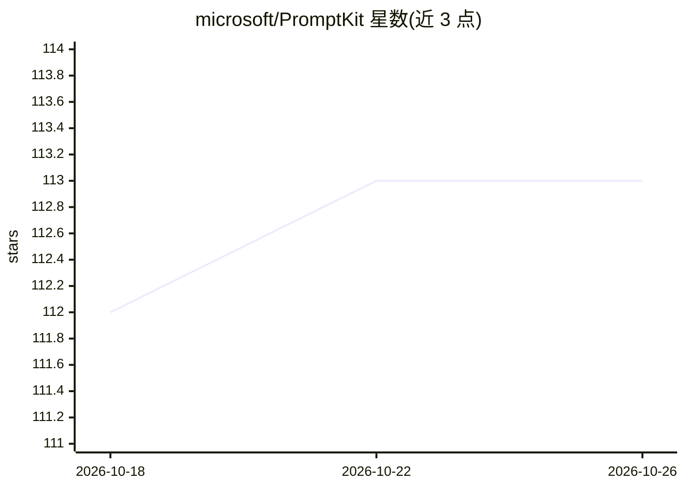

# microsoft/PromptKit

⭐ 113 · JavaScript · MIT · 推送 2026-10-14 · [GitHub](https://github.com/microsoft/PromptKit) · 组织维护

**可组合、版本化提示词组件库，覆盖工程任务全流程**

微软维护的提示词工程库：157 个组件（15 personas、48 protocols、21 formats、5 taxonomies、64 templates），通过 manifest.yaml 组合为面向软件、硬件、固件、协议等领域的任务提示词。提供三个交互式工作流（Bootstrap 规格提取、Evolve 变更演化、Maintain 漂移检测），模板间以输入输出契约链接成四条流水线。运行需 Node.js 18+，通过 npx 启动，配合 GitHub Copilot CLI / Claude Code / Codex CLI 等 LLM 工具使用，也可手动粘贴引导文件。

## 筛选速览

| 维度 | 判定 | 备注 |
|---|---|---|
| AI 角色 | `ai-ecosystem` | LLM/agent 周边工具 |
| 许可风险 | `permissive` | MIT |
| 部署形态 | `library` | 以包/库形式分发 |
| 模型依赖 | — | README 未给出锁定关系 |
| 硬件要求 | — | 无带数字的原话,不猜 |
| 安装摩擦 | `medium` | 含编译或系统依赖之一 |
| 成熟度 | — | 结构信号不足 |

## 能力要点

- 157 个可组合提示词组件，分 5 层架构（persona/protocol/format/taxonomy/template）
- 模板声明输入输出契约，可链接为 4 条流水线（文档/硬件/协议/工程生命周期）
- 规格漂移审计使用 D1–D16 分类法标注位置、证据与严重度
- npx 直接运行，自动检测本机 LLM CLI

## 适用场景

- 让 LLM 按结构化流程做代码评审、缺陷调查或设计文档
- 从既有代码库反向提取需求/设计/验证规格
- 跟踪需求变更并审计规格与实现间的漂移
- 硬件原理图评审与 BOM 审计等非软件工程任务

## 场景标签

`提示工程` · 领域:Agent 开发

## 证据(README 行号)

> L11: PromptKit treats prompts as engineered artifacts. It gives you composable,
> L19: A composable, versioned prompt library for engineering tasks — software,
> L50: - **Node.js 18+** — Install Node.js (required for `npx @alan-jowett/promptkit`)

## 星数曲线

2026-10-18 112 → 2026-10-26 113（+1）

---
*卡片 v1 · prompt 1.4 · 生成 2026-10-23 · 置信度 high · 依据 README sha `5e93941f9c7a` · [字段定义](../../DATASET.md)*
