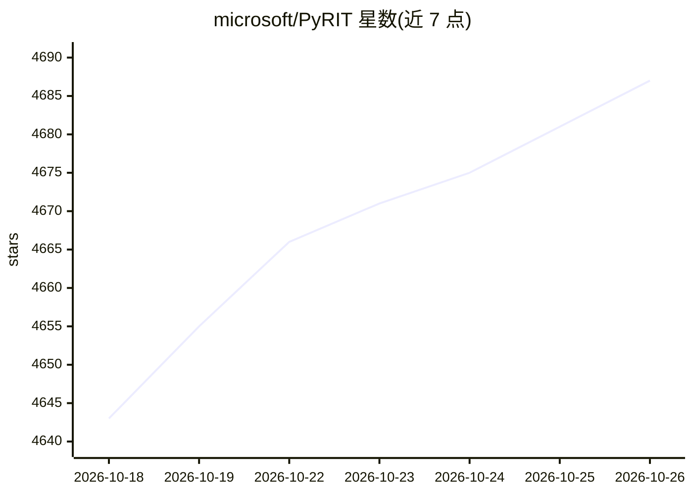

# microsoft/PyRIT

⭐ 4,687 · Python · MIT · 推送 2026-10-25 · [GitHub](https://github.com/microsoft/PyRIT) · [官网](https://microsoft.github.io/PyRIT/) · 组织维护

**生成式 AI 系统风险识别的 Python 红队开源框架**

由 Microsoft 维护的开源框架 PyRIT（Python Risk Identification Tool），面向安全专业人员与工程师，用于主动识别生成式 AI 系统中的风险。README 提供项目网站指引安装、使用与贡献方式，说明漏洞可通过 Microsoft Security Response Center 私下报告，并提供 Discord 社区渠道。附带论文引用（CITATION.cff），标题为 PyRIT: Democratizing AI Red Teaming Through Open-Source Tooling。README 本身未展示具体安装命令与功能细节。

## 筛选速览

| 维度 | 判定 | 备注 |
|---|---|---|
| AI 角色 | `ai-ecosystem` | LLM/agent 周边工具 |
| 许可风险 | `permissive` | MIT |
| 部署形态 | `None` |  |
| 模型依赖 | — | README 未给出锁定关系 |
| 硬件要求 | — | 无带数字的原话,不猜 |
| 安装摩擦 | `low` | 无编译、无系统依赖或容器化 |
| 成熟度 | — | 结构信号不足 |

## 能力要点

- 面向生成式 AI 系统的风险识别（红队）框架
- 由 Microsoft 维护，提供项目网站与 Discord 社区
- 支持通过 MSRC 私下报告安全漏洞
- 附论文引用文件 CITATION.cff

## 适用场景

- 安全团队对生成式 AI 系统开展红队测试
- 工程师在发布前识别生成式 AI 的风险
- 研究者引用并使用该工具开展 AI 安全研究

## 场景标签

`网络安全` `模型评测` · 领域:评测与运维

## 证据(README 行号)

> L3: The Python Risk Identification Tool for generative AI (PyRIT) is an open source
> L4: framework built to empower security professionals and engineers to proactively
> L5: identify risks in generative AI systems.

## 星数曲线

2026-10-18 4,643 → 2026-10-26 4,687（+44）

---
*卡片 v1 · prompt 1.4 · 生成 2026-10-20 · 置信度 mid · 依据 README sha `ac564b8b7d69` · [字段定义](../../DATASET.md)*
