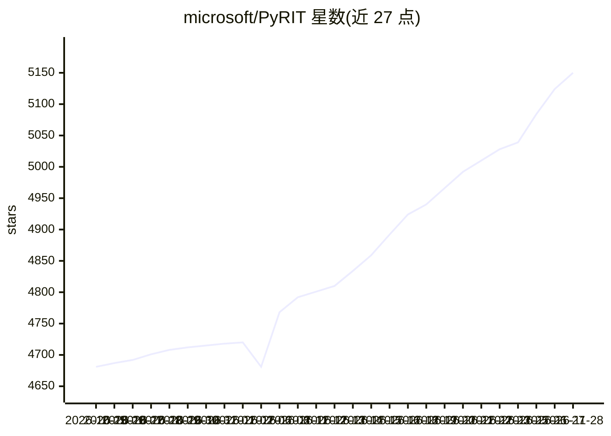

# microsoft/PyRIT

⭐ 5,150 · Python · MIT · 推送 2026-11-27 · [GitHub](https://github.com/microsoft/PyRIT) · [官网](https://microsoft.github.io/PyRIT/) · 组织维护

**微软开源的生成式 AI 红队测试工具包**

PyRIT（Python Risk Identification Tool for generative AI）用于以自动化扫描、自适应多轮攻击与人工测试方式发现生成式 AI 系统的安全与安全合规弱点。提供命令行扫描器、浏览器图形界面（CoPyRIT GUI）和可扩展的 Python 框架三种形态，支持通过 HTTP、WebSocket、Playwright 浏览器自动化或自定义目标测试完整应用端点。由微软 AI 红队与开源社区维护，提供 Discord 社区与贡献指南；可用功能取决于目标系统与模型。

## 筛选速览

| 维度 | 判定 | 备注 |
|---|---|---|
| AI 角色 | `ai-ecosystem` | LLM/agent 周边工具 |
| 许可风险 | `permissive` | MIT |
| 部署形态 | `None` |  |
| 模型依赖 | local-ok | 支持本地模型 |
| 硬件要求 | — | 无带数字的原话,不猜 |
| 安装摩擦 | `low` | 无编译、无系统依赖或容器化 |
| 成熟度 | — | 结构信号不足 |

## 能力要点

- 命令行扫描器支持可重复的自动化评估
- 图形界面在浏览器中交互探索并审查结果
- Python 框架可组合与扩展组件构建自定义红队工作流
- 支持 HTTP/WebSocket/Playwright 浏览器自动化等多种端点接入方式

## 适用场景

- 上线前对生成式 AI 应用做自动化安全扫描
- 与红队成员协作交换测试技术并贡献代码
- 为自有模型端点编写定制化红队测试流程

## 场景标签

`模型评测` `网络安全` · 领域:评测与运维

## 证据(README 行号)

> L7: PyRIT (Python Risk Identification Tool for generative AI) is an open-source toolkit
> L12: PyRIT brings a command-line scanner, a graphical interface, and an extensible

## 星数曲线

2026-10-25 4,681 → 2026-11-28 5,150（+469）

---
*卡片 v1 · prompt 1.4 · 生成 2026-11-22 · 置信度 high · 依据 README sha `fdd8e0476801` · [字段定义](../../DATASET.md)*
