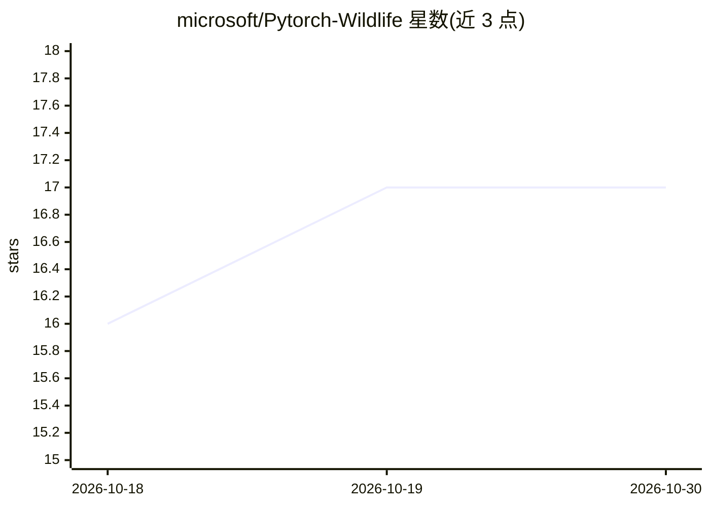

# microsoft/Pytorch-Wildlife

⭐ 17 · Python · MIT · 推送 2026-10-29 · [GitHub](https://github.com/microsoft/Pytorch-Wildlife) · [官网](https://microsoft.github.io/Pytorch-Wildlife/) · 组织维护

**野生动物监测深度学习框架：相机陷阱检测与物种分类**

Microsoft AI for Good Lab 维护的开源深度学习框架，用于生物多样性监测：托管 MegaDetector 系列相机陷阱动物检测模型（YOLOv10/v9/v5、RT-DETR）、面向亚马逊/塞伦盖蒂/欧洲等生态系统的物种分类器及声学分析模型，支持从单张图片推理到大规模批处理。注意：项目已停止维护，1.3.1 为最终版本，推理工作由 SPARROW-Engine 继续。

## 筛选速览

| 维度 | 判定 | 备注 |
|---|---|---|
| AI 角色 | `ai-native` | 本体是模型或模型工具 |
| 许可风险 | `permissive` | MIT |
| 部署形态 | `library` | 以包/库形式分发 |
| 模型依赖 | — | README 未给出锁定关系 |
| 硬件要求 | — | 无带数字的原话,不猜 |
| 安装摩擦 | `low` | 无编译、无系统依赖或容器化 |
| 成熟度 | — | 结构信号不足 |

## 能力要点

- MegaDetector V5/V6 相机陷阱动物检测模型
- 多地区生态系统物种分类器（亚马逊/塞伦盖蒂/欧洲等）
- 支持单图推理与大规模批处理
- 提供 Hugging Face 演示与 Google Colab notebook

## 适用场景

- 对相机陷阱影像做动物检测与物种分类
- 生态研究中的大规模影像批处理
- 在浏览器或 Colab 中试用模型不本地安装

## 场景标签

`目标检测` · 领域:感知与多模态

## 证据(README 行号)

> L15: **Unified open-source AI framework for wildlife monitoring and conservation.**
> L20: **MegaDetector**, the most widely used camera-trap detection model in conservation, is invoked through PyTorch-Wild
> L44: |`MegaDetectorV6`|YOLOv10 / YOLOv9 / RT-DETR|Animal detection in camera-trap images|

## 星数曲线

2026-10-18 16 → 2026-10-30 17（+1）

---
*卡片 v1 · prompt 1.4 · 生成 2026-10-29 · 置信度 high · 依据 README sha `3ebb2985b9ab` · [字段定义](../../DATASET.md)*
