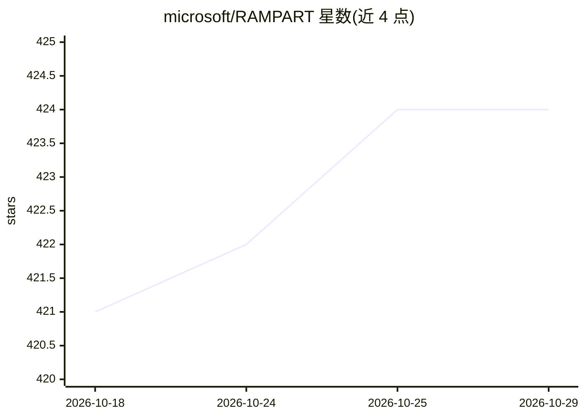

# microsoft/RAMPART

⭐ 424 · Python · MIT · 推送 2026-10-26 · [GitHub](https://github.com/microsoft/RAMPART) · [官网](https://microsoft.github.io/RAMPART/) · 组织维护

**面向 AI agent 的安全红队测试框架（pytest 原生）**

微软开源的 pytest 原生安全测试框架，用于对 agentic AI 应用编写与运行安全和安全性测试：覆盖对抗攻击、良性失败与多类伤害类别，以评测驱动的断言形式提供，并与 pytest 集成。附带 RAMPARTner 引导式上手技能（SKILL.md 格式，随仓库与 Python 包分发），帮助在编码助手中协商首个测试目标、构建集成并选择后续测试与载荷。面向需要为 agent 建立安全回归测试的开发者。

## 筛选速览

| 维度 | 判定 | 备注 |
|---|---|---|
| AI 角色 | `ai-ecosystem` | LLM/agent 周边工具 |
| 许可风险 | `permissive` | MIT |
| 部署形态 | `library` | 以包/库形式分发 |
| 模型依赖 | — | README 未给出锁定关系 |
| 硬件要求 | — | 无带数字的原话,不猜 |
| 安装摩擦 | `low` | 无编译、无系统依赖或容器化 |
| 成熟度 | — | 结构信号不足 |

## 能力要点

- pytest 原生集成，以评测驱动断言编写 agent 安全测试
- 覆盖对抗攻击、良性失败与多类伤害类别
- RAMPARTner 上手技能随包分发，引导构建首个测试

## 适用场景

- 为 AI agent 编写可回归运行的安全与红队测试
- 在 pytest 流水线中检测对抗攻击与良性失败场景
- 借助编码助手技能快速上手构建首个安全测试

## 场景标签

`模型评测` · 领域:评测与运维

## 证据(README 行号)

> L6:  A pytest-native safety and security testing framework for agentic AI applications.
> L14: RAMPART provides a structured, developer-friendly way to write and run safety and security tests for AI agents -- c

## 星数曲线

2026-10-18 421 → 2026-10-29 424（+3）

---
*卡片 v1 · prompt 1.4 · 生成 2026-10-21 · 置信度 high · 依据 README sha `326dcf2ed723` · [字段定义](../../DATASET.md)*
