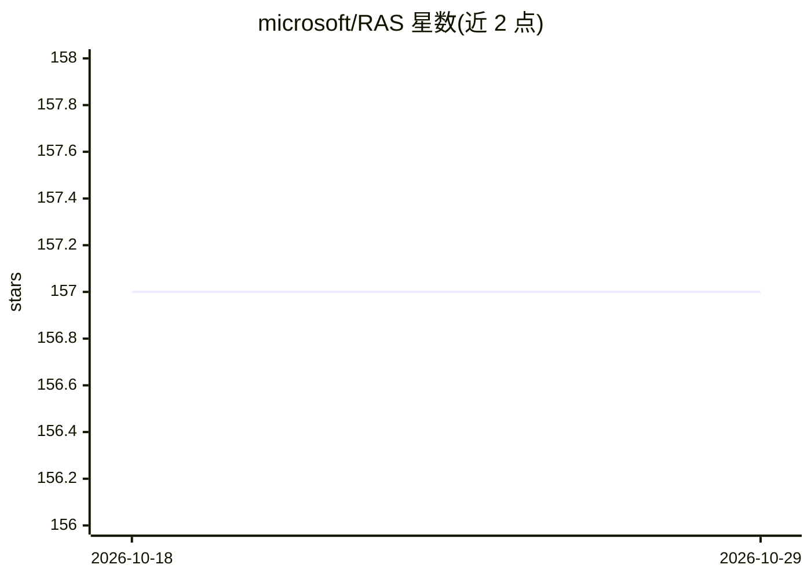

# microsoft/RAS

⭐ 157 · Python · MIT · 推送 2026-04-10 · [GitHub](https://github.com/microsoft/RAS) · [官网](https://aka.ms/ras-dit) · 组织维护

**扩散 Transformer 的区域自适应采样库：加速推理**

CVPR 2026 论文 Region-Adaptive Sampling 的开源实现。它不再对图像所有区域做均匀采样，而是基于区域注意力与噪声度量动态调整每步采样比例，对复杂区域分配更多计算、简单区域复用先前输出，以减少推理计算量。训练无关，通过包装 Diffusers 管线接入 Stable Diffusion 3、Lumina-Next-T2I 等现有 DiT 模型；提供 sample_ratio、metric、error_reset_steps 等超参数调节吞吐与质量的权衡。需先按官方文档安装 PyTorch，从源码安装使用。

## 筛选速览

| 维度 | 判定 | 备注 |
|---|---|---|
| AI 角色 | `ai-ecosystem` | LLM/agent 周边工具 |
| 许可风险 | `permissive` | MIT |
| 部署形态 | `None` |  |
| 模型依赖 | — | README 未给出锁定关系 |
| 硬件要求 | — | 无带数字的原话,不猜 |
| 安装摩擦 | `low` | 无编译、无系统依赖或容器化 |
| 成熟度 | — | 结构信号不足 |

## 能力要点

- 基于区域注意力与噪声度量的动态采样比例调整
- 训练无关，包装现有 Diffusers 管线即可使用
- 支持 Stable Diffusion 3 与 Lumina-Next-T2I 示例
- sample_ratio/metric/starvation_scale 等超参数调节质量与吞吐

## 适用场景

- 给已有扩散模型管线加速推理、降低采样计算量
- 研究扩散 Transformer 的采样策略与区域化计算分配
- 在生成质量与吞吐之间做参数化权衡实验

## 场景标签

`推理引擎` · 领域:训练与推理

## 证据(README 行号)

> L5: The RAS library is an open-source implementation of Regional-Adaptive Sampling (RAS), a novel diffusion model sampli
> L12: - User-Friendly API: Easily experiment with the DiT models by simply wrapping the pipeline with the RAS API.

## 星数曲线

2026-10-18 157 → 2026-10-29 157（+0）

---
*卡片 v1 · prompt 1.4 · 生成 2026-10-22 · 置信度 high · 依据 README sha `4843767ff2e3` · [字段定义](../../DATASET.md)*
