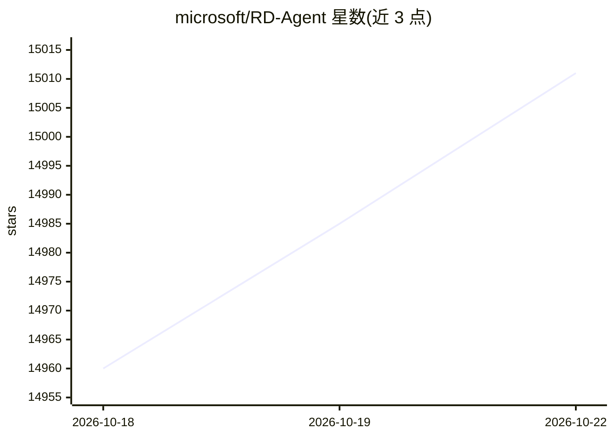

# microsoft/RD-Agent

⭐ 15,011 · Python · MIT · 推送 2026-10-20 · [GitHub](https://github.com/microsoft/RD-Agent) · [官网](https://rdagent.azurewebsites.net/) · 组织维护

**微软自动化研发流程的 Agent：自动化模型与数据研发迭代**

微软开源的研发自动化框架，将 R&D 过程拆解为提出想法（R）与实现（D）两类组件，应用于量化交易因子/模型演化、数据挖掘、论文/财报读取并实现模型、Kaggle 竞赛特征工程、LLM 微调等场景。后端默认通过 LiteLLM 接入多家模型提供商，仅支持 Linux，多数场景依赖 Docker，通过 PyPI 安装或源码开发安装，提供 `rdagent health_check` 健康检查与 Web UI。

## 筛选速览

| 维度 | 判定 | 备注 |
|---|---|---|
| AI 角色 | `ai-native` | 本体是模型或模型工具 |
| 许可风险 | `permissive` | MIT |
| 部署形态 | `self-host` | docker 或自建部署 |
| 模型依赖 | locked-api |  |
| 硬件要求 | — | 无带数字的原话,不猜 |
| 安装摩擦 | `low` | 无编译、无系统依赖或容器化 |
| 成熟度 | — | 结构信号不足 |

## 动量与使用信号

- 维护:`active` — 距上次 push 1.6 天,年发版 2,40 位贡献者
- 涨星:近 1 天 **+8**(自 20261016 起算)
- 安装:pypi 包 `rdagent` 月下载 3,914
- 平台:LINUX / WEB · 协议:OPENAI-API

## 能力要点

- R（提出想法）+D（实现）双组件框架，覆盖量化、数据科学、医疗等多个场景命令
- 默认 LiteLLM 后端接入多家 LLM 提供商，提供 OpenAI/Azure OpenAI/DeepSeek 配置示例
- 在 MLE-bench（75 个 Kaggle 竞赛数据集）上提交运行结果并公开详细 runs
- 提供 `rdagent server_ui` Web 前端用于实时交互与 trace 查看

## 适用场景

- 自动化量化交易中因子与模型的联合迭代演化
- 读取论文/财报并自动实现模型结构或构建数据集
- 参加 Kaggle 竞赛时自动做特征工程与模型调优
- 对领域模型做基准驱动的自主 LLM 微调

## 场景标签

`金融量化` `微调` `Agent 框架` `数据分析` · 领域:Agent 开发

## 证据(README 行号)

> L97: R&D-Agent aims to automate the most critical and valuable aspects of the industrial R&D process, and we begin with 
> L98: Methodologically, we have identified a framework with two key components: 'R' for proposing new ideas and 'D' for i
> L119: ### RD-Agent currently only supports Linux.

## 星数曲线

2026-10-18 14,960 → 2026-10-22 15,011（+51）

---
*卡片 v1 · prompt 1.4 · 生成 2026-10-18 · 置信度 mid · 依据 README sha `19db531830fc` · [字段定义](../../DATASET.md)*
