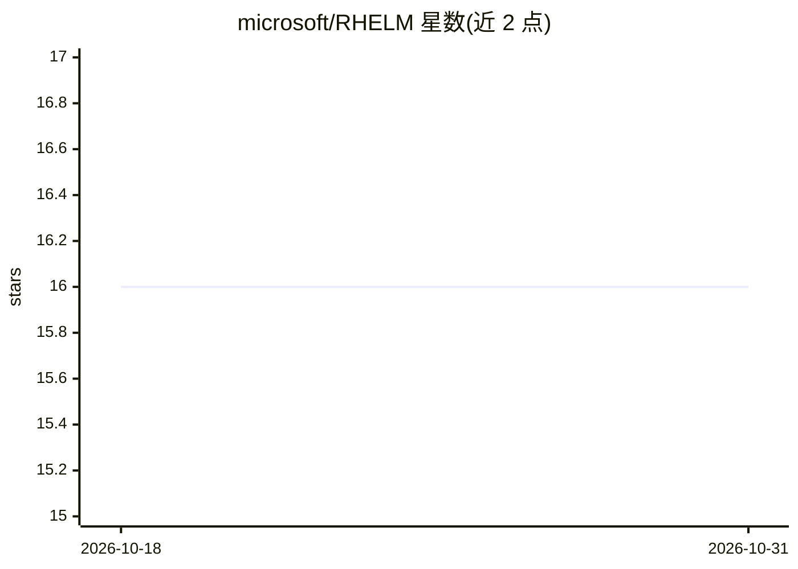

# microsoft/RHELM

⭐ 16 · HTML · MIT · 推送 2026-09-15 · [GitHub](https://github.com/microsoft/RHELM) · 组织维护

**评测 AI 助手长时记忆能力的基准与评测框架**

微软发布的长时程记忆评测基准：构建包含对话、邮件、文档等异构外部记忆源的演化式场景，以 7 大类 27 种细粒度特性的问答（事实、时序、聚合、幻觉、误导、附件、混合）考察 RAG 基线、长上下文模型与记忆框架三类系统，问答以 JSONL 提供，含 ground-truth 答案与证据引用。附 Python 评测框架，LLM 凭据经环境变量读取，数据托管于 HuggingFace，数据生成管线待论文接收后发布。

## 筛选速览

| 维度 | 判定 | 备注 |
|---|---|---|
| AI 角色 | `ai-ecosystem` | LLM/agent 周边工具 |
| 许可风险 | `permissive` | MIT |
| 部署形态 | `None` |  |
| 模型依赖 | — | README 未给出锁定关系 |
| 硬件要求 | — | 无带数字的原话,不猜 |
| 安装摩擦 | `low` | 无编译、无系统依赖或容器化 |
| 成熟度 | — | 结构信号不足 |

## 能力要点

- 7 大类 27 种细粒度挑战的问题分类体系
- 含时序演化与'误导性查询'陷阱（需检测冲突并拒绝）
- 对 RAG 基线/长上下文模型/记忆框架三类系统的排行榜
- 评测框架含证据引用字段（supporting_evidence）

## 适用场景

- 评测自家 RAG 或记忆框架的长时记忆能力
- 对比长上下文模型在时序与幻觉类问题上的表现
- 作为长程记忆研究的标准化问答数据集

## 场景标签

`模型评测` `Agent 记忆` · 领域:Agent 开发

## 证据(README 行号)

> L16: RHELM is a comprehensive benchmark for evaluating long-horizon memory capabilities in AI systems. Unlike existing b
> L36: We evaluate three families of systems — **RAG Baselines**, **Long-Context Models**, and **Memory Frameworks** — und

## 星数曲线

2026-10-18 16 → 2026-10-31 16（+0）

---
*卡片 v1 · prompt 1.4 · 生成 2026-10-30 · 置信度 high · 依据 README sha `fb8322cb1479` · [字段定义](../../DATASET.md)*
