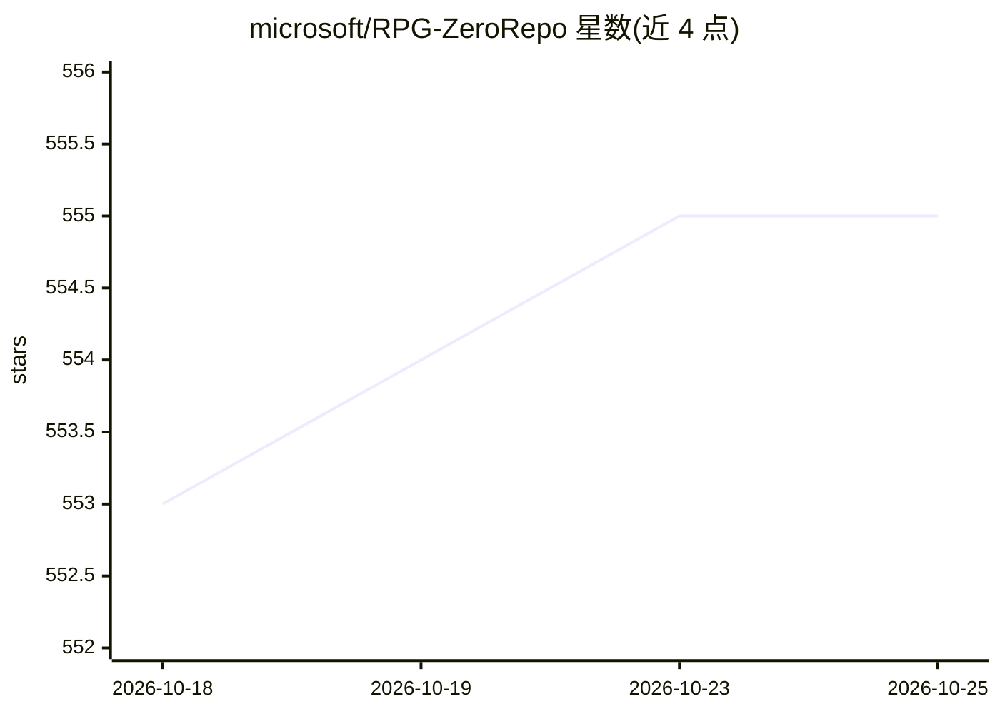

# microsoft/RPG-ZeroRepo

⭐ 555 · Python · MIT · 推送 2026-10-23 · [GitHub](https://github.com/microsoft/RPG-ZeroRepo) · 组织维护 · 中文 README

**面向长程编码 agent 的仓库规划图控制层与研究管线**

微软开源的仓库规划图（RPG）项目：CoderMind 为 Claude Code 与 GitHub Copilot 提供持久化 RPG 工作区，通过 CLI（cmind init）、slash 命令与 MCP 图工具支持仓库规划、多文件生成、仓库理解与图感知编辑，可用 post-commit hook 保持图与代码同步。另含独立研究代码：ZeroRepo 实现需求→RPG→仓库的正向生成管线，RPG-Encoder 实现仓库→RPG 的逆向编码与增量演化，RepoCraft 提供 1,052 任务的评测集。RPG 论文被 ICLR 2026 接收，RPG-Encoder 被 ICML 2026 接收。

## 筛选速览

| 维度 | 判定 | 备注 |
|---|---|---|
| AI 角色 | `ai-ecosystem` | LLM/agent 周边工具 |
| 许可风险 | `permissive` | MIT |
| 部署形态 | `None` |  |
| 模型依赖 | — | README 未给出锁定关系 |
| 硬件要求 | — | 无带数字的原话,不猜 |
| 安装摩擦 | `low` | 无编译、无系统依赖或容器化 |
| 成熟度 | — | 结构信号不足 |

## 能力要点

- CoderMind 为 Claude Code/GitHub Copilot 提供持久 RPG 工作区（CLI、slash 命令、MCP 图工具）
- RPG-Encoder 从既有代码库抽取 RPG 并支持提交级增量演化
- ZeroRepo 三阶段管线：特征规划→架构设计→图引导依赖序代码生成
- RepoCraft 基准：6 个真实 Python 项目的 1,052 个仓库级任务

## 适用场景

- 让编码 agent 在长任务中保持仓库级规划上下文
- 把既有代码库编码为可检索的结构化规划图
- 复现 RPG/RPG-Encoder 论文管线与仓库级代码生成评测

## 场景标签

`代码生成` `模型评测` `Agent 记忆` · 领域:Agent 开发

## 证据(README 行号)

> L16: CoderMind gives agents a **persistent RPG workspace** so they can plan, generate, understand, and update repositori
> L102: CoderMind exposes the RPG workspace through three interfaces:
> L110: **Supported agents:** Claude Code (verified), GitHub Copilot (verified).

## 星数曲线

2026-10-18 553 → 2026-10-25 555（+2）

---
*卡片 v1 · prompt 1.4 · 生成 2026-10-21 · 置信度 high · 依据 README sha `50be7f3746a5` · [字段定义](../../DATASET.md)*
