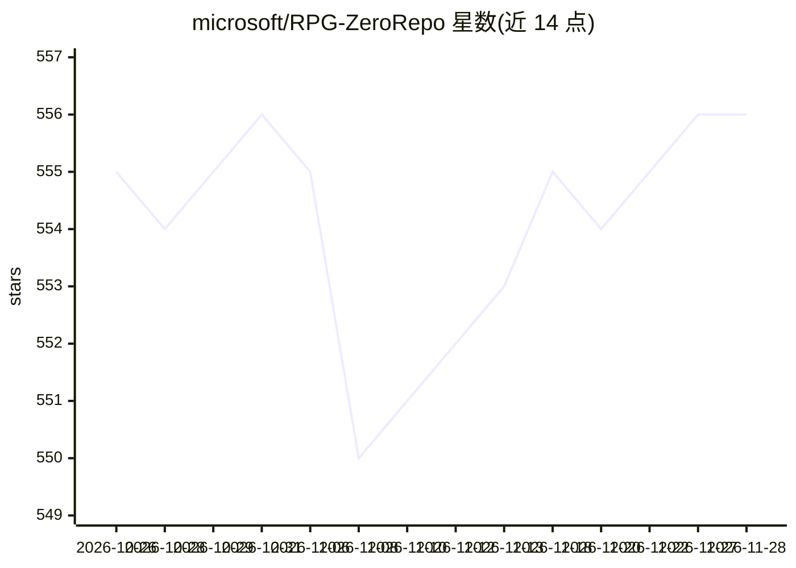

# microsoft/RPG-ZeroRepo

⭐ 556 · Python · MIT · 推送 2026-11-19 · [GitHub](https://github.com/microsoft/RPG-ZeroRepo) · 组织维护 · 中文 README

**为长程编码 agent 提供持久仓库规划图（RPG）工作区的控制层**

将 Repository Planning Graph 作为编码 agent 的持久工作区：包含面向 agent 的 CoderMind（CLI 初始化、slash 命令、MCP 图工具三接口，支持 Claude Code 与 GitHub Copilot），以及可脱离 agent 运行的研究代码——ZeroRepo 正向管线（需求→RPG→仓库，三阶段：特征规划、架构设计、图引导生成）与 RPG-Encoder 反向管线（仓库→RPG，含编码/演化/操作三机制），另附 RepoCraft 基准（6 个真实 Python 项目、1,052 个任务，覆盖/准确率/代码统计指标）。Python 3.11+，MIT 许可。

## 筛选速览

| 维度 | 判定 | 备注 |
|---|---|---|
| AI 角色 | `ai-ecosystem` | LLM/agent 周边工具 |
| 许可风险 | `permissive` | MIT |
| 部署形态 | `None` |  |
| 模型依赖 | locked-api |  |
| 硬件要求 | — | 无带数字的原话,不猜 |
| 安装摩擦 | `low` | 无编译、无系统依赖或容器化 |
| 成熟度 | — | 结构信号不足 |

## 能力要点

- CoderMind 通过 CLI、slash 命令与 MCP 工具（search_rpg/explore_rpg 等）暴露 RPG 工作区
- ZeroRepo 正向管线按依赖顺序生成相互关联的文件，支持 checkpoint 与 resume
- RPG-Encoder 支持 commit 级 diff 的增量维护，避免全量重编码
- RepoCraft 基准含 1,052 个任务与单元测试/语义检查指标

## 适用场景

- 从自然语言需求生成完整的仓库级代码库
- 把现有代码库编码为 RPG 后进行搜索、解释与影响分析
- 复现论文或评测模型的仓库级代码生成能力

## 场景标签

`代码生成` `编码 Agent` `Agent 记忆` `模型评测` · 领域:Agent 开发

## 证据(README 行号)

> L42: CoderMind turns Repository Planning Graphs into a control layer for long-horizon AI coding agents.
> L112: **Supported agents:** Claude Code (verified), GitHub Copilot (verified).
> L133: CoderMind (above) is the agent-facing layer that uses RPGs from either direction. The components below run **witho

## 星数曲线

2026-10-26 555 → 2026-11-28 556（+1）

---
*卡片 v1 · prompt 1.4 · 生成 2026-11-25 · 置信度 high · 依据 README sha `a3d2225a8235` · [字段定义](../../DATASET.md)*
