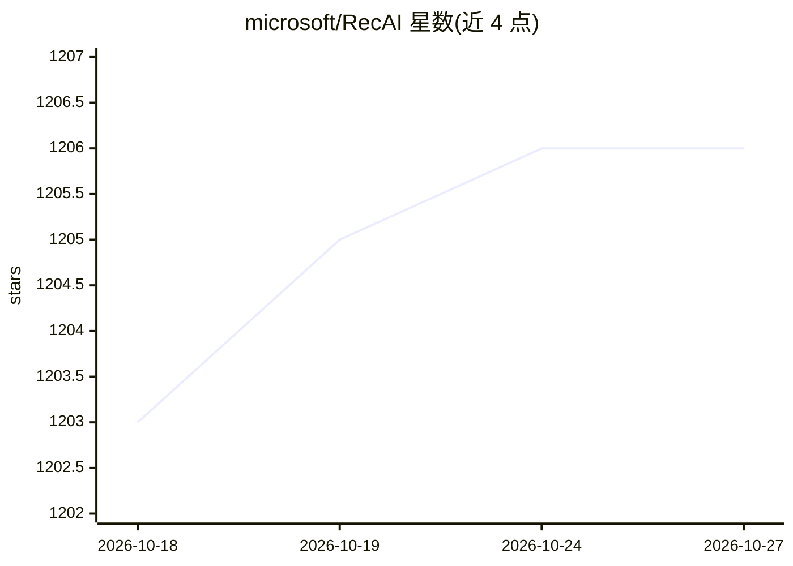

# microsoft/RecAI

⭐ 1,206 · Jupyter Notebook · MIT · 推送 2026-01-27 · [GitHub](https://github.com/microsoft/RecAI) · 组织维护

**微软 LLM4Rec 研究项目集：将 LLM 集成进推荐系统的多种方法**

微软研究院维护的 LLM4Rec 研究项目集合，围绕把大语言模型引入推荐系统展开，含六个子方向：以 LLM 为大脑、传统推荐模型为工具的对话式推荐 Agent（InteRecAgent）；通过个性化提示注入领域知识的选择性知识插件；面向物品检索优化的嵌入模型 RecLM-emb；经 SFT/RL 微调的生成式推荐模型 RecLM-gen；用 LLM 作代理模型解释推荐系统的 RecExplainer；以及评估 LM 推荐系统的 RecLM Evaluator。各子项目均附论文，采用 MIT 许可。

## 筛选速览

| 维度 | 判定 | 备注 |
|---|---|---|
| AI 角色 | `ai-ecosystem` | LLM/agent 周边工具 |
| 许可风险 | `permissive` | MIT |
| 部署形态 | `None` |  |
| 模型依赖 | — | README 未给出锁定关系 |
| 硬件要求 | — | 无带数字的原话,不猜 |
| 安装摩擦 | `low` | 无编译、无系统依赖或容器化 |
| 成熟度 | — | 结构信号不足 |

## 能力要点

- 六个 LLM4Rec 子方向：Agent、知识插件、嵌入/生成推荐模型、解释器、评估器
- RecLM Evaluator 支持评估已训练 LM 或 API（如 Azure OpenAI）
- 各子项目均提供对应学术论文

## 适用场景

- 研究 LLM 与推荐系统结合的不同技术路线
- 构建对话式、可解释的交互推荐系统
- 评估语言模型推荐系统的检索、排序与解释能力

## 场景标签

`推荐系统` · 领域:学习与行业

## 证据(README 行号)

> L7: The RecAI project aims to bridge this gap by investigating various strategies to integrate LLMs into recommender sys
> L9: We believe that by adopting a holistic perspective, we can incorporate the majority of practical requirements of LLM
> L38: Evaluation is crucial for assessing the true capabilities of models and identifying areas of weakness for further i

## 星数曲线

2026-10-18 1,203 → 2026-10-27 1,206（+3）

---
*卡片 v1 · prompt 1.4 · 生成 2026-10-21 · 置信度 mid · 依据 README sha `4e9134365a3e` · [字段定义](../../DATASET.md)*
