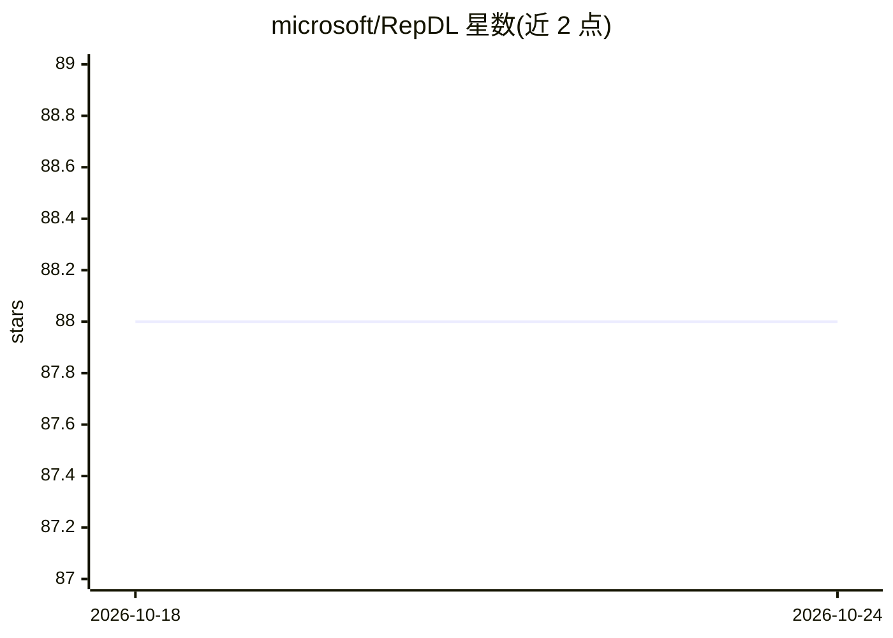

# microsoft/RepDL

⭐ 88 · Cuda · MIT · 推送 2025-11-25 · [GitHub](https://github.com/microsoft/RepDL) · 组织维护

**跨硬件保证 PyTorch 训练/推理逐位一致的深度学习库**

微软维护的深度学习库，面向需要可复现性的研究场景：在相同训练或推理任务下，跨不同硬件平台保证逐位（bitwise）一致的结果。提供 repdl.from_torch_module 包装现有 PyTorch 模型实现可复现推理，repdl.ops 定义可复现算子（C++/CUDA 后端实现），repdl.nn 提供 PyTorch 兼容函数与模块，目前仅覆盖子集。需预装 PyTorch 与对应 CUDA，源码构建安装；README 声明本产品仅供学术与非生产用途。

## 筛选速览

| 维度 | 判定 | 备注 |
|---|---|---|
| AI 角色 | `ai-ecosystem` | LLM/agent 周边工具 |
| 许可风险 | `permissive` | MIT |
| 部署形态 | `library` | 以包/库形式分发 |
| 模型依赖 | — | README 未给出锁定关系 |
| 硬件要求 | — | 无带数字的原话,不猜 |
| 安装摩擦 | `medium` | 含编译或系统依赖之一 |
| 成熟度 | — | 结构信号不足 |

## 能力要点

- 跨硬件平台的逐位一致训练与推理保证
- repdl.from_torch_module 包装现有 PyTorch 模型
- repdl.ops/nn 提供确定性算子与 PyTorch 兼容函数模块
- 通过固定浮点运算顺序、避免非 IEEE-754 指令实现可复现性

## 适用场景

- 研究成果需要在不同 GPU 型号上复现完全一致的训练结果
- 验证模型输出与 logit 在跨设备环境下的哈希一致性
- 在确定性需求实验中替换 PyTorch 的非确定性算子

## 场景标签

`科研工具` · 领域:学习与行业

## 证据(README 行号)

> L5: RepDL is a specialized library designed to facilitate reproducible deep learning by guaranteeing **bitwise identical
> L42: RepDL defines reproducible operations in `repdl.ops`, and implements them in `repdl.backend`. Building on these ope

## 星数曲线

2026-10-18 88 → 2026-10-24 88（+0）

---
*卡片 v1 · prompt 1.4 · 生成 2026-10-23 · 置信度 mid · 依据 README sha `82c690a8c5eb` · [字段定义](../../DATASET.md)*
