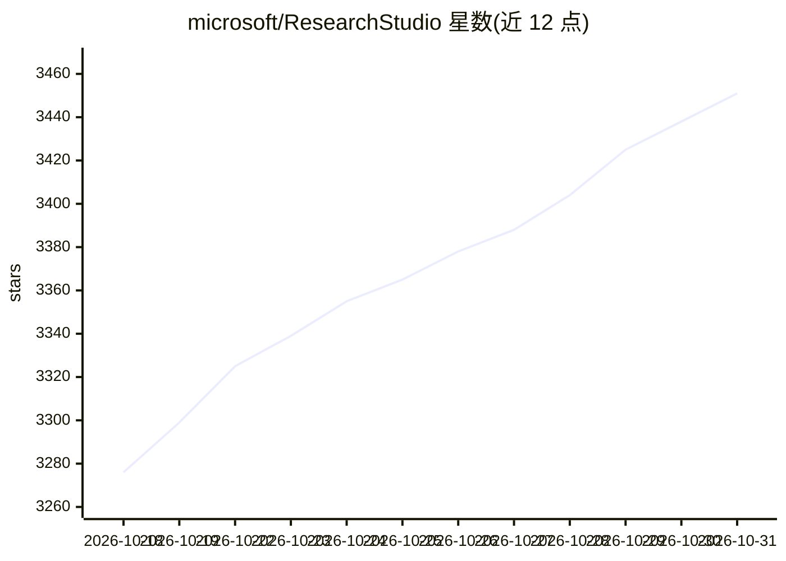

# microsoft/ResearchStudio

⭐ 3,451 · Python · MIT · 推送 2026-09-21 · [GitHub](https://github.com/microsoft/ResearchStudio) · [官网](https://aka.ms/ResearchStudio) · 组织维护

**覆盖科研全流程的 AI 协作技能集：从选题到论文产出物**

微软维护的科研全生命周期技能集合，以技能形式运行于 Claude Code 与 Codex：Idea 部分将未明确的研究方向转化为可辩护、可实现的 idea 卡片（基于 ICLR/ICML/NeurIPS 投稿语料归纳的分类法）；Reel 部分将论文 PDF 转为印刷级海报、带解说的视频、双语博客与交互式 reel。另有可独立于 LLM 运行的 pptx2video CLI。安装支持 conda/uv 环境下的源码 install.sh 或 npx 交互安装器；建议模型版本 claude-opus-4.6 以上或 gpt-5.5 以上。

## 筛选速览

| 维度 | 判定 | 备注 |
|---|---|---|
| AI 角色 | `ai-native` | 本体是模型或模型工具 |
| 许可风险 | `permissive` | MIT |
| 部署形态 | `library` | 以包/库形式分发 |
| 模型依赖 | locked-api |  |
| 硬件要求 | — | 无带数字的原话,不猜 |
| 安装摩擦 | `low` | 无编译、无系统依赖或容器化 |
| 成熟度 | — | 结构信号不足 |

## 能力要点

- IdeaSpark 端到端生成 reviewer-defensible 的 idea 卡片
- 论文 PDF 转海报、解说视频、双语博客与交互式 reel
- pptx2video 可不依赖 LLM 以 CLI 运行
- 技能可运行于 Claude Code 与 Codex

## 适用场景

- 把模糊的研究方向转化为可实施的选题方案
- 论文发表后自动生成海报、视频与博客等传播材料
- 将可编辑 PPT 幻灯片转为带字幕与动画的解说视频

## 场景标签

`科研工具` `视频生成` `AI 写作` · 领域:内容生成

## 证据(README 行号)

> L11: ResearchStudio is a collection of skills covering the **entire research lifecycle** — from an under-specified resea
> L12: The skills run on Claude Code and Codex.

## 星数曲线

2026-10-18 3,276 → 2026-10-31 3,451（+175）

---
*卡片 v1 · prompt 1.4 · 生成 2026-10-20 · 置信度 high · 依据 README sha `960772606f9a` · [字段定义](../../DATASET.md)*
