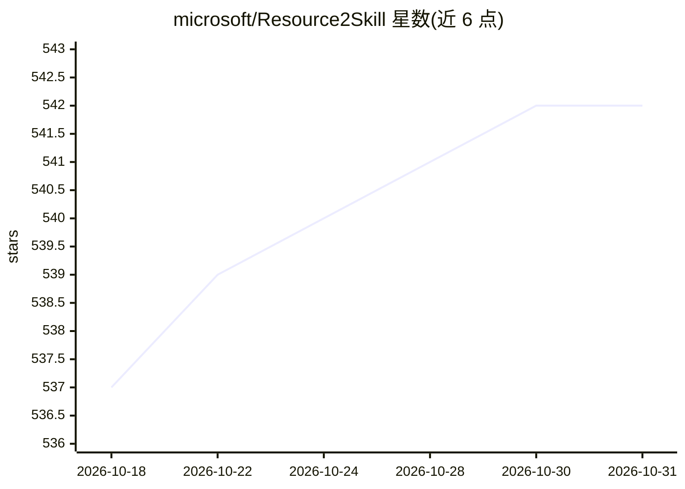

# microsoft/Resource2Skill

⭐ 542 · Python · MIT · 推送 2026-10-29 · [GitHub](https://github.com/microsoft/Resource2Skill) · [官网](https://aka.ms/Resource2Skill) · 组织维护

**将人类多模态资源蒸馏为可执行 agent 技能的框架与运行时**

微软开源的框架，把教程视频、参考制品、文章、代码等人类创作的资源转化为软件 agent 可浏览、组合、执行的技能库，并通过领域 MCP 服务器在实际软件工具中产出网页、PowerPoint、Excel 工作簿、Blender 场景与 REAPER 风格音频。提供可运行运行时与技能库，CLI 按领域（web/ppt/excel/blender/reaper）调用 agent，模型后端通过 .env 配置 Azure OpenAI。技能库发布在 Hugging Face，需 Python 3.11 虚拟环境，各领域另需安装 Playwright/LibreOffice/fluidsynth/bpy 等系统依赖。

## 筛选速览

| 维度 | 判定 | 备注 |
|---|---|---|
| AI 角色 | `ai-ecosystem` | LLM/agent 周边工具 |
| 许可风险 | `permissive` | MIT |
| 部署形态 | `library` | 以包/库形式分发 |
| 模型依赖 | — | README 未给出锁定关系 |
| 硬件要求 | — | 无带数字的原话,不猜 |
| 安装摩擦 | `low` | 无编译、无系统依赖或容器化 |
| 成熟度 | — | 结构信号不足 |

## 能力要点

- 从多模态资源蒸馏出可浏览/组合/执行的技能库
- 覆盖 web、PowerPoint、Excel、Blender、REAPER 音频等领域
- CLI 按领域运行 agent，技能库含 wiki 条目与可执行资产两部分
- 蒸馏数据集发布于 Hugging Face（microsoft/RESOURCE2SKILL）

## 适用场景

- 让 agent 依据蒸馏技能生成网页、PPT、Excel 等产物
- 为软件 agent 构建可复用、可组合的技能库
- 研究者复现论文中跨领域的技能蒸馏流程

## 场景标签

`Agent 框架` `多模态` · 领域:Agent 开发

## 证据(README 行号)

> L12: Resource2Skill turns human-created resources (tutorial videos, reference
> L13: artifacts, articles, code) into reusable executable skills that a software agent
> L111: (executable assets used by the domain MCP servers).

## 星数曲线

2026-10-18 537 → 2026-10-31 542（+5）

---
*卡片 v1 · prompt 1.4 · 生成 2026-10-21 · 置信度 high · 依据 README sha `ff3f7b4de761` · [字段定义](../../DATASET.md)*
