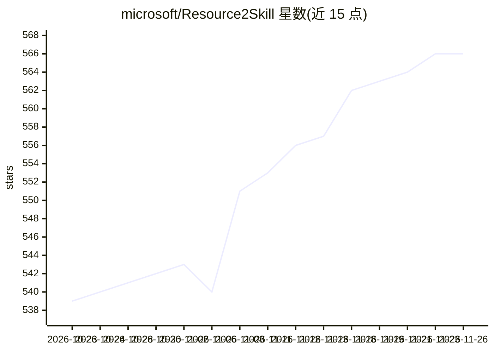

# microsoft/Resource2Skill

⭐ 566 · Python · MIT · 推送 2026-11-05 · [GitHub](https://github.com/microsoft/Resource2Skill) · [官网](https://aka.ms/Resource2Skill) · 组织维护 · 中文 README

**将人类多模态资源蒸馏为 agent 可执行技能的框架**

微软官方开源的 Resource2Skill，把教程视频、文章、代码等人类创作资源蒸馏成可复用的可执行技能，供软件 agent 通过 skills_wiki 浏览检索、经 MCP 服务器运行 skills_library 中的可执行资产。运行时为 Python 3.11 项目，覆盖 Web、PowerPoint、Excel、Blender、REAPER 音频五个域，各域有独立系统依赖（Playwright、LibreOffice、fluidsynth、bpy）。技能库发布在 Hugging Face 数据集，附论文引用。

## 筛选速览

| 维度 | 判定 | 备注 |
|---|---|---|
| AI 角色 | `ai-ecosystem` | LLM/agent 周边工具 |
| 许可风险 | `permissive` | MIT |
| 部署形态 | `library` | 以包/库形式分发 |
| 模型依赖 | locked-api |  |
| 硬件要求 | — | 无带数字的原话,不猜 |
| 安装摩擦 | `low` | 无编译、无系统依赖或容器化 |
| 成熟度 | — | 结构信号不足 |

## 能力要点

- 蒸馏生成可浏览/检索/组合/执行的 agent 技能库（wiki + executable assets 双结构）
- 跨 Web/PPT/Excel/Blender/REAPER 五个域验证，CLI 提供 agent 调用入口
- 技能库以 Hugging Face 数据集形式发布
- 基于 MCP 服务器执行域内工具

## 适用场景

- 让 agent 根据人类教程资源自动生成 PPT、Excel 等工作产物
- 为 agent 构建可组合的领域技能库
- 在不同软件工具域中验证技能蒸馏方法

## 场景标签

`Agent 框架` · 领域:Agent 开发

## 证据(README 行号)

> L14: This repository is the official Microsoft open-source release of Resource2Skill.
> L17: artifacts, articles, code) into reusable executable skills that a software agent
> L113: At runtime the agent reads from two roots in this repo: `skills_wiki/<domain>/`

## 星数曲线

2026-10-23 539 → 2026-11-26 566（+27）

---
*卡片 v1 · prompt 1.4 · 生成 2026-11-25 · 置信度 high · 依据 README sha `c693134e6bcf` · [字段定义](../../DATASET.md)*
