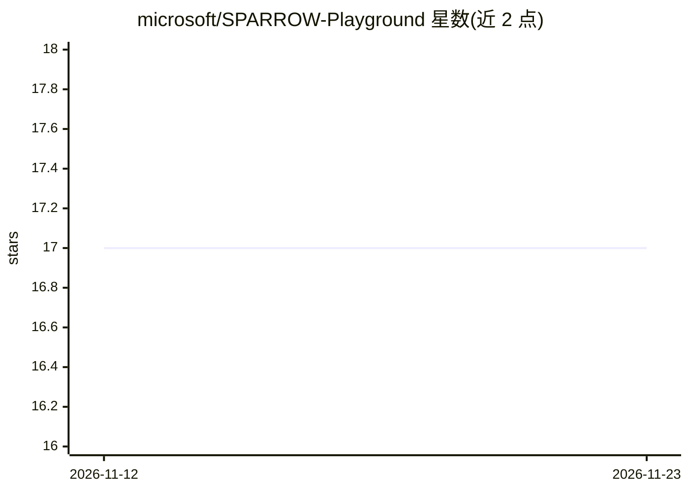

# microsoft/SPARROW-Playground

⭐ 17 · Jupyter Notebook · MIT · 推送 2026-11-12 · [GitHub](https://github.com/microsoft/SPARROW-Playground) · [官网](https://microsoft.github.io/SPARROW-Playground/) · 组织维护

**微软生物多样性 AI 工具的实验场：相机陷阱/音频/视频数据上运行检测模型**

Microsoft AI for Good Lab 的 notebook 与脚本草稿仓库（前身为 Pytorch-Wildlife），供数据科学家加载相机陷阱图像、视频或音频文件，用 Sparrow Engine（Rust 编写、基于 ONNX Runtime 的推理引擎）运行 MegaDetector 检测、区域物种分类、鸟类鸣声识别、BioCLIP 嵌入检索，并支持摄像头/RTSP 实时检测，结果可导出为 MegaDetector JSON、COCO 或 CSV。仅运行模型，不训练；模型库含 82 个模型。旧 PytorchWildlife 包保留在 PyPI 1.3.1 但不再更新。

## 筛选速览

| 维度 | 判定 | 备注 |
|---|---|---|
| AI 角色 | `ai-native` | 本体是模型或模型工具 |
| 许可风险 | `permissive` | MIT |
| 部署形态 | `library` | 以包/库形式分发 |
| 模型依赖 | — | README 未给出锁定关系 |
| 硬件要求 | — | 无带数字的原话,不猜 |
| 安装摩擦 | `low` | 无编译、无系统依赖或容器化 |
| 成熟度 | — | 结构信号不足 |

## 能力要点

- MegaDetector 检测动物/人/车辆并叠加区域物种分类器
- 82 个模型库覆盖相机陷阱、声学、高空与海洋影像
- 支持摄像头/RTSP 实时检测与 JSON/COCO/CSV 导出
- notebook 11-15 经 sparrow-comm 接收野外设备（FTPS/邮件/Reconyx）数据

## 适用场景

- 在相机陷阱图像上批量检测动物并分类到物种
- 从 WAV 录音中检测鸟类并识别物种
- 用 BioCLIP 嵌入做图像相似度检索
- 接收野外相机上传的图像并在到达时立即运行检测

## 场景标签

`目标检测` `语义搜索` · 领域:知识与检索

## 证据(README 行号)

> L18: SPARROW Playground is where you try out the biodiversity tools from the Microsoft AI for Good Lab.
> L25: - find animals, people and vehicles in camera-trap images and videos with MegaDetector;
> L27: - detect birds and identify species in audio recordings;

## 星数曲线

2026-11-12 17 → 2026-11-23 17（+0）

---
*卡片 v1 · prompt 1.4 · 生成 2026-11-18 · 置信度 high · 依据 README sha `4a877a0c1e9c` · [字段定义](../../DATASET.md)*
