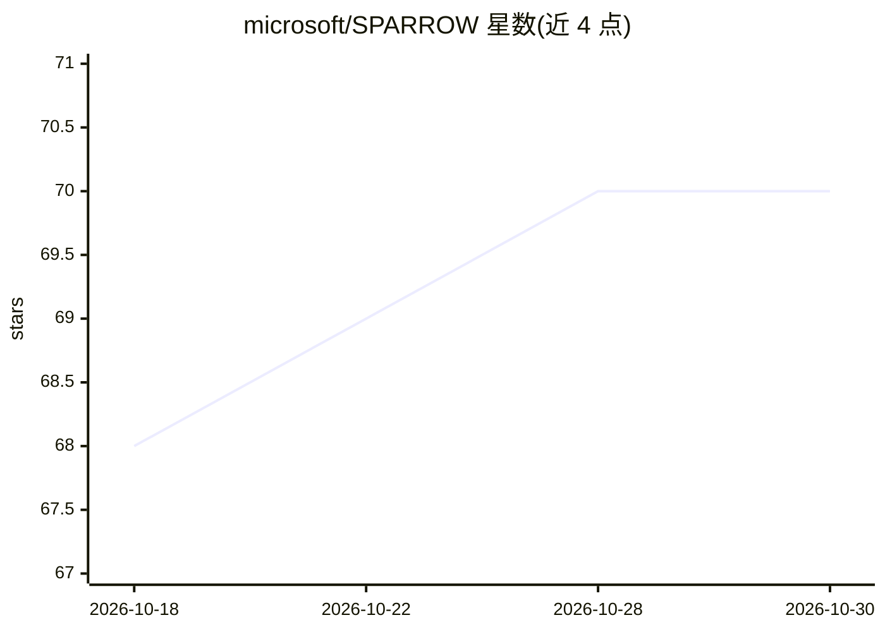

# microsoft/SPARROW

⭐ 70 · Python · MIT · 推送 2026-10-24 · [GitHub](https://github.com/microsoft/SPARROW) · [官网](https://unlocked.microsoft.com/project-sparrow/) · 组织维护

**太阳能供电的野生动植物监测 AI 边缘设备客户端，给保护研究者**

微软 AI for Good Lab 开发的边缘计算方案：太阳能供电、离网运行，集成相机陷阱、AudioMoth 声学监测与环境传感器采集生物多样性数据，在 Raspberry Pi 5 上通过 ONNXRuntime 运行 PyTorch 野生动物模型（导出为 ONNX）实现实时图像与声学检测、物种分类与事件识别，经低轨卫星（Starlink）将数据回传云端或本地设施。本仓库为 SPARROW 客户端：数据采集、设备端推理、电源管理、遥测与安全传输，服务以 Docker Compose 编排。README 提供硬件物料清单（BOM）与组装指引；硬件需自行采购组装，Jetson 支持已停止，由社区维护分支承接。

## 筛选速览

| 维度 | 判定 | 备注 |
|---|---|---|
| AI 角色 | `ai-native` | 本体是模型或模型工具 |
| 许可风险 | `permissive` | MIT |
| 部署形态 | `self-host` | docker 或自建部署 |
| 模型依赖 | — | README 未给出锁定关系 |
| 硬件要求 | — | 无带数字的原话,不猜 |
| 安装摩擦 | `low` | 无编译、无系统依赖或容器化 |
| 成熟度 | — | 结构信号不足 |

## 能力要点

- 设备端运行 PyTorch 野生动物模型（ONNX/ONNXRuntime）做检测与物种分类
- 太阳能充电、电池健康监测与动态组件调度的自主离网运行
- 低轨卫星（Starlink Mini）回传，离线安全记录、恢复连接后自动同步
- 所有服务以 Docker Compose 编排运行

## 适用场景

- 在偏远生态系统部署长期生物多样性监测站
- 野外相机陷阱图像与声学数据的实时物种检测
- 保护研究人员远程获取近实时的野外观测数据

## 场景标签

`目标检测` `推理引擎` · 领域:感知与多模态

## 证据(README 行号)

> L11: **SPARROW**, developed by **Microsoft's AI for Good Lab**, is an **AI-powered edge computing solution** designed to
> L13: Solar-powered and equipped with advanced sensors, it collects biodiversity data—from camera traps, acoustic monitor
> L26:  Runs optimized PyTorch Wildlife models (exported to ONNX) on a Raspberry Pi 5 via ONNXRuntime for real-time image 

## 星数曲线

2026-10-18 68 → 2026-10-30 70（+2）

---
*卡片 v1 · prompt 1.4 · 生成 2026-10-24 · 置信度 high · 依据 README sha `d3dff458d982` · [字段定义](../../DATASET.md)*
