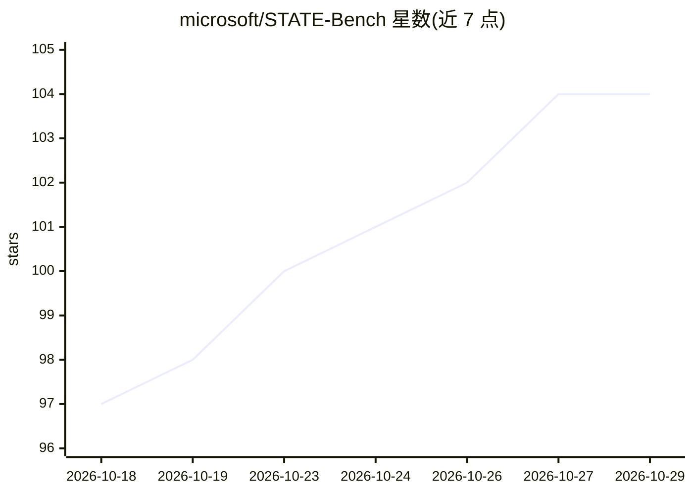

# microsoft/STATE-Bench

⭐ 104 · Python · MIT · 推送 2026-08-04 · [GitHub](https://github.com/microsoft/STATE-Bench) · [官网](https://microsoft.github.io/STATE-Bench/leaderboard/) · 组织维护

**评测 AI agent 在企业多步工作流任务上的基准（450 任务）**

微软维护的企业工作流 agent 基准：在旅行、客服、购物助手三个领域共 450 个多步任务上评测 AI agent。每个任务提供任务本地沙盒数据库、领域工具与模拟用户，agent 需完成信息收集、策略应用、数据库状态更新与对话流程遵循。提供主赛道与 Agent Learning 赛道（后者增加训练轨迹与检索钩子）。指标包括 pass@1、pass^5、LLM 评审的 UX 分与每任务成本。数据由大语言模型合成生成，README 声明仅供研究用途。

## 筛选速览

| 维度 | 判定 | 备注 |
|---|---|---|
| AI 角色 | `ai-ecosystem` | LLM/agent 周边工具 |
| 许可风险 | `permissive` | MIT |
| 部署形态 | `None` |  |
| 模型依赖 | — | README 未给出锁定关系 |
| 硬件要求 | — | 无带数字的原话,不猜 |
| 安装摩擦 | `low` | 无编译、无系统依赖或容器化 |
| 成熟度 | — | 结构信号不足 |

## 能力要点

- 450 个任务覆盖旅行/客服/购物三个企业领域
- 每任务提供沙盒数据库、领域工具与模拟用户
- 四项指标：pass@1、pass^5、UX Score、Cost Per Task
- Agent Learning 赛道支持记忆/技能/提示词优化评测

## 适用场景

- 评测我的 agent 在多步企业任务上的完成率
- 比较不同模型在带策略约束的企业工作流中的表现
- 评测 agent 记忆与技能学习机制的效果

## 场景标签

`模型评测` · 领域:评测与运维

## 证据(README 行号)

> L10: STATE-Bench evaluates AI agents on realistic, multi-step enterprise workflows across three domains: **travel**, **c
> L16: STATE-Bench includes 450 challenging enterprise tasks across three domains.

## 星数曲线

2026-10-18 97 → 2026-10-29 104（+7）

---
*卡片 v1 · prompt 1.4 · 生成 2026-10-23 · 置信度 high · 依据 README sha `a8d4d318027a` · [字段定义](../../DATASET.md)*
