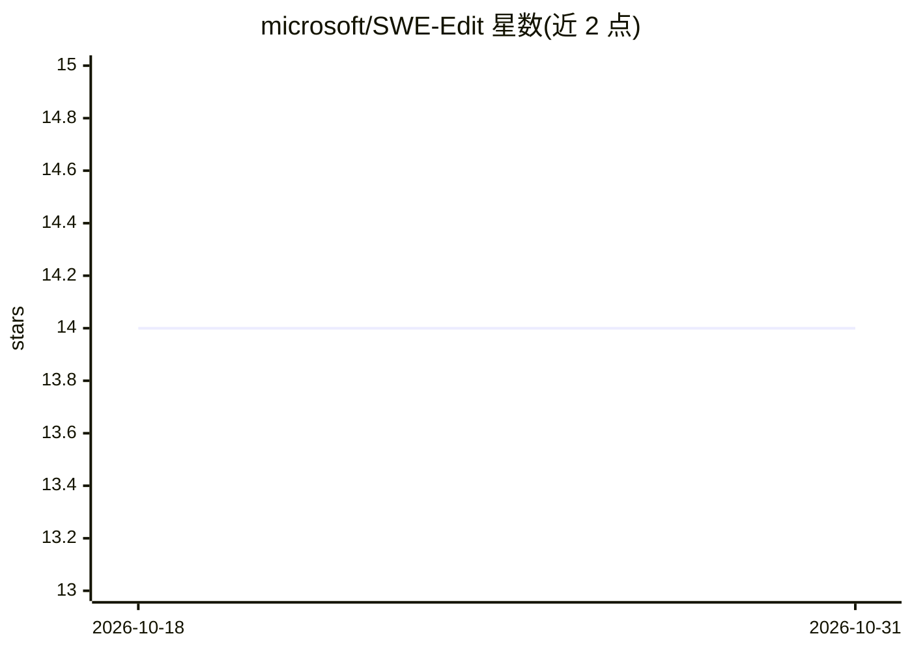

# microsoft/SWE-Edit

⭐ 14 · Python · MIT · 推送 2026-07-13 · [GitHub](https://github.com/microsoft/SWE-Edit) · 组织维护

**面向软件工程 Agent 的代码编辑双优化框架（论文官方代码）**

微软发布的论文 "SWE-Edit: Rethinking Code Editing for Efficient SWE-Agent" 官方仓库。方法分两层：脚手架层将编辑接口拆为 Viewer 子代理（按需抽取任务相关代码片段）与 Editor 子代理（按自然语言指令执行修改）；模型层用 GRPO 训练自适应编辑器，在 find-replace 与整文件重写两种模式间选择。在 SWE-bench Verified 上报告 Resolved 72.0%、成本较基线下降 17.9%。以 Python 包形式提供，基于 uv 管理环境，支持 OpenAI/Anthropic/Azure OpenAI 配置与多 API key 负载均衡。

## 筛选速览

| 维度 | 判定 | 备注 |
|---|---|---|
| AI 角色 | `ai-ecosystem` | LLM/agent 周边工具 |
| 许可风险 | `permissive` | MIT |
| 部署形态 | `None` |  |
| 模型依赖 | locked-api |  |
| 硬件要求 | — | 无带数字的原话,不猜 |
| 安装摩擦 | `low` | 无编译、无系统依赖或容器化 |
| 成熟度 | — | 结构信号不足 |

## 能力要点

- Viewer/Editor 子代理拆分编辑接口，解耦推理与格式敏感的生成
- GRPO 训练的自适应编辑器在 find-replace 与整文件重写间选择
- SWE-bench Verified 完整评测脚本（500 实例）
- 主代理与子代理可配置不同模型，支持多 API key 负载均衡

## 适用场景

- 研究者复现论文的 SWE-bench Verified 评测
- 构建或改造 LLM 软件工程 Agent 的代码编辑模块
- 在成本受限场景下用更小的模型承担编辑/查看子任务

## 场景标签

`编码 Agent` `模型评测` `强化学习` · 领域:编码与开发

## 证据(README 行号)

> L12: **SWE-Edit** is a dual-optimization framework that improves both the performance and efficiency of code editing in 
> L18: 1. **Scaffolding-Level Optimization**: Decomposing the code editing interface into specialized subagents
> L22: 2. **Model-Level Optimization**: Training an adaptive editor with GRPO that learns to select between editing modes 

## 星数曲线

2026-10-18 14 → 2026-10-31 14（+0）

---
*卡片 v1 · prompt 1.4 · 生成 2026-10-31 · 置信度 high · 依据 README sha `e8b6a9acea7e` · [字段定义](../../DATASET.md)*
