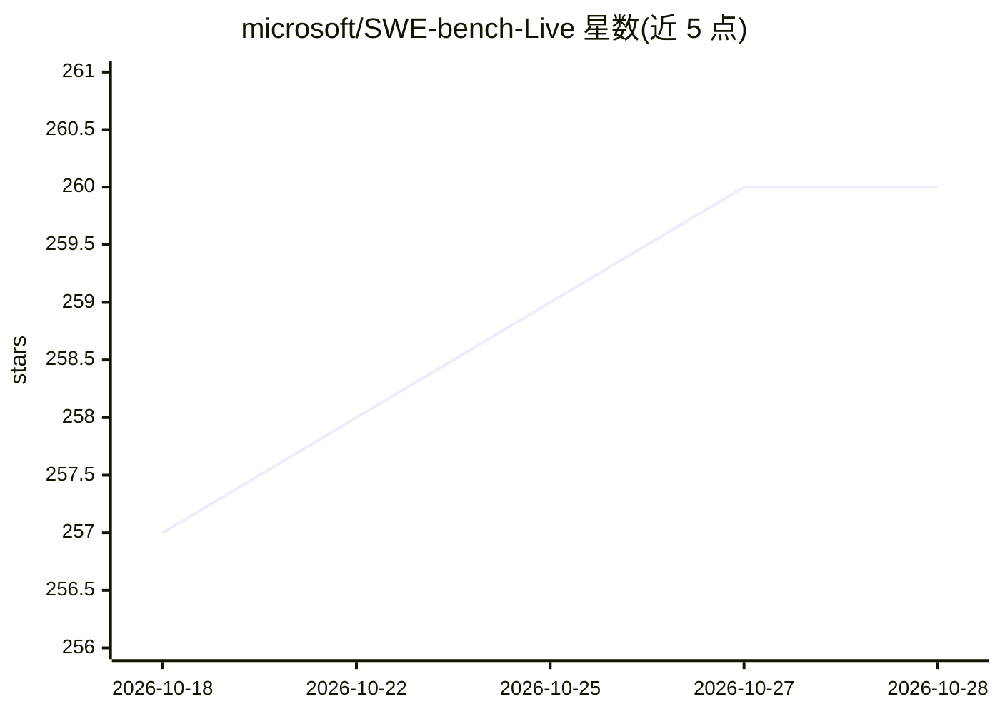

# microsoft/SWE-bench-Live

⭐ 260 · Python · MIT · 推送 2026-09-25 · [GitHub](https://github.com/microsoft/SWE-bench-Live) · [官网](https://swe-bench-live.github.io/) · 组织维护

**自动更新的多语言 SWE 基准数据集与评测脚本**

微软维护的软件工程任务基准：自动策展管线持续生成 SWE 任务，覆盖 Python、C/C++、Java、Go、Rust 等多语言及 Windows 环境，每月新增 50 条经核验的 issue 到 full split。仓库提供评测脚本（在 HuggingFace 公开数据集上评估 agent 补丁）与任务创建源码（含可执行 Docker 沙箱，用于 agentic RFT/RL），并通过 LLM 驱动的 RepoLaunch 工具自动构建可测试容器环境。评测严格遵循原 SWE-bench 协议。

## 筛选速览

| 维度 | 判定 | 备注 |
|---|---|---|
| AI 角色 | `ai-knowledge` | 知识聚合/清单类 |
| 许可风险 | `permissive` | MIT |
| 部署形态 | `library` | 以包/库形式分发 |
| 模型依赖 | — | README 未给出锁定关系 |
| 硬件要求 | — | 无带数字的原话,不猜 |
| 安装摩擦 | `low` | 无编译、无系统依赖或容器化 |
| 成熟度 | — | 结构信号不足 |

## 能力要点

- 自动更新管线每月新增 50 条核验 issue
- 多语言（8 语言/431 仓库）与 Windows 任务集
- 提供评测脚本与自定义任务创建源码
- RepoLaunch 自动为 GitHub 仓库构建可测试容器环境

## 适用场景

- 评测 agent/模型在真实 issue 修复上的成功率
- 为 agentic RFT/RL 大规模生成带沙箱的 SWE 训练任务
- 提交结果到 leaderboard 与同类基准对比

## 场景标签

`模型评测` · 领域:评测与运维

## 证据(README 行号)

> L20: SWE-bench-Live is the **first automatically-updating, multi-language and multi-os** SWE task set designed for agent
> L21: 1. The **evaluation script** to evaluate the prediction patches of your agent on our public huggingface datasets: _

## 星数曲线

2026-10-18 257 → 2026-10-28 260（+3）

---
*卡片 v1 · prompt 1.4 · 生成 2026-10-22 · 置信度 high · 依据 README sha `6182d2c6e2eb` · [字段定义](../../DATASET.md)*
