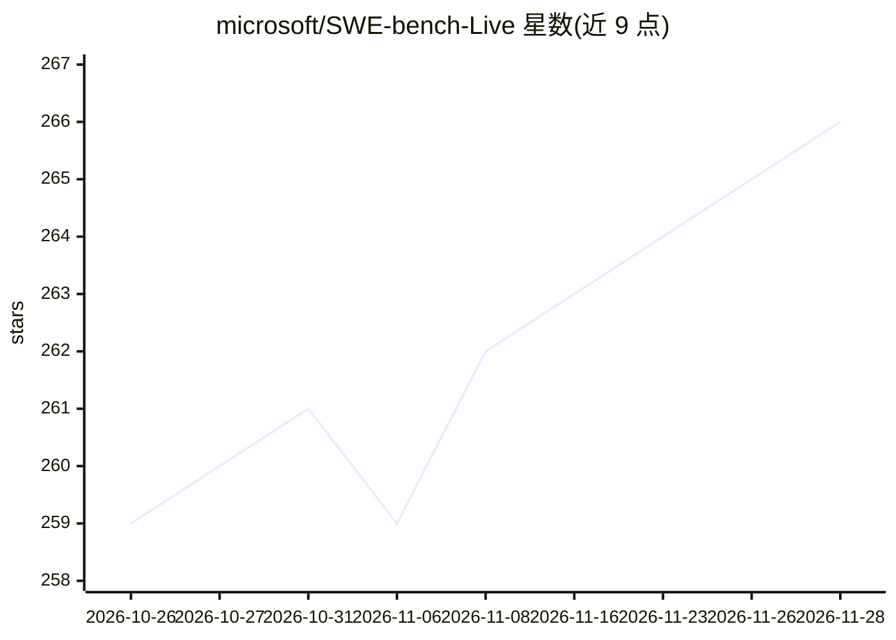

# microsoft/SWE-bench-Live

⭐ 266 · Python · MIT · 推送 2026-11-24 · [GitHub](https://github.com/microsoft/SWE-bench-Live) · [官网](https://swe-bench-live.github.io/) · 组织维护

**为 agent 开发者提供持续更新的多语言 SWE 基准与评测工具**

微软维护的持续更新的 SWE-bench 类基准：提供 Hugging Face 上的 Python、多语言与 Windows 任务集，配套评估脚本以 docker 沙箱运行 agent 的预测补丁并判定通过率；附任务创建源码（含 RepoLaunch 自动构建环境工具），支持自建任务用于大规模 RFT/RL 训练。评测遵循原 SWE-bench 协议，结果经 PR 提交并须附 rollout 轨迹以供合规核验。安装依赖 Git、Python 3.12 与 Docker。

## 筛选速览

| 维度 | 判定 | 备注 |
|---|---|---|
| AI 角色 | `ai-ecosystem` | LLM/agent 周边工具 |
| 许可风险 | `permissive` | MIT |
| 部署形态 | `library` | 以包/库形式分发 |
| 模型依赖 | — | README 未给出锁定关系 |
| 硬件要求 | — | 无带数字的原话,不猜 |
| 安装摩擦 | `low` | 无编译、无系统依赖或容器化 |
| 成熟度 | — | 结构信号不足 |

## 能力要点

- 持续更新的任务集：每月新增 50 条 Python 问题，MultiLang 覆盖 8 种语言 1077 条实例
- 提供评估脚本与 docker 沙箱运行 agent 预测补丁
- 附任务创建源码与 RepoLaunch 自动构建可测试容器环境
- 带公开排行榜与结果提交合规流程

## 适用场景

- 评测我的代码修复 agent 在真实 GitHub issue 上的表现
- 为 agent 训练（RFT/RL）批量自建带沙箱的 SWE 任务
- 对比模型在多语言、Windows 平台任务上的通过率

## 场景标签

`模型评测` `强化学习` · 领域:评测与运维

## 证据(README 行号)

> L20: SWE-bench-Live is the **first automatically-updating, multi-language and multi-os** SWE task set designed for agent
> L21: 1. The **evaluation script** to evaluate the prediction patches of your agent on our public huggingface datasets: _
> L22: 2. The **task-creation source code** for you to create your customized SWE tasks for large-scale agentic RFT/RL, ea

## 星数曲线

2026-10-26 259 → 2026-11-28 266（+7）

---
*卡片 v1 · prompt 1.4 · 生成 2026-11-25 · 置信度 high · 依据 README sha `7c2e59db653a` · [字段定义](../../DATASET.md)*
