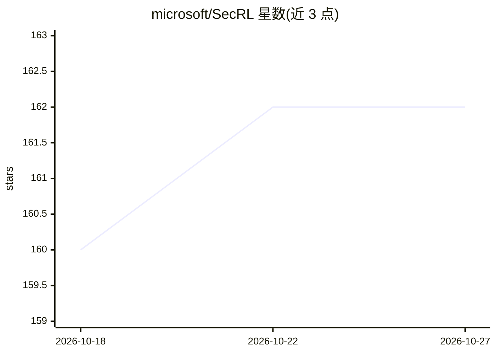

# microsoft/SecRL

⭐ 162 · Jupyter Notebook · MIT · 推送 2026-10-14 · [GitHub](https://github.com/microsoft/SecRL) · [官网](https://arxiv.org/abs/2507.14201) · 组织维护

**评测 LLM agent 网络威胁调查能力的基准**

微软发布的 ExCyTIn-Bench：以安全问答对形式测试 LLM agent 的威胁狩猎能力。环境含两个部分：8 个安全事件对应的 MySQL 数据库（Docker 容器运行，占约 10GB 磁盘）与基于事件图生成的问题答案集（可用 OpenAI O1/O3 生成的现有集或自行生成）。通过 AG2 Classic 调用模型 API，Python 3.11 安装运行，提供基线运行脚本与评测日志。论文被 ICML 2026 接收；新版推荐迁移至 ACESEvals 运行基准与 RLVR 训练。

## 筛选速览

| 维度 | 判定 | 备注 |
|---|---|---|
| AI 角色 | `ai-knowledge` | 知识聚合/清单类 |
| 许可风险 | `permissive` | MIT |
| 部署形态 | `self-host` | docker 或自建部署 |
| 模型依赖 | — | README 未给出锁定关系 |
| 硬件要求 | — | 无带数字的原话,不猜 |
| 安装摩擦 | `low` | 无编译、无系统依赖或容器化 |
| 成熟度 | — | 结构信号不足 |

## 能力要点

- 8 个安全事件数据库（Docker 容器化 MySQL，约 10GB 磁盘）
- 基于事件图与 LLM 生成的问题答案对，含路径相关性 train-test 划分
- 支持 OpenAI O1/O3 生成的问题集与基线评测脚本
- 评测结果覆盖 Claude、GPT、Qwen、Grok 等模型

## 适用场景

- 评测 LLM agent 在网络威胁调查/威胁狩猎任务上的表现
- 复现论文中各模型的基准结果
- 作为 RLVR 训练安全 agent 的基准环境

## 场景标签

`模型评测` `网络安全` · 领域:评测与运维

## 证据(README 行号)

> L16: We present the first benchmark to test LLM-based agents on threat hunting in the form of security question-answerin
> L20: 2. A set of generated questions and answers for testing in `secgym/questions/tests` folder, or from huggingface.
> L26: 1. Download database from Hugging Face.

## 星数曲线

2026-10-18 160 → 2026-10-27 162（+2）

---
*卡片 v1 · prompt 1.4 · 生成 2026-10-22 · 置信度 high · 依据 README sha `a357912dc391` · [字段定义](../../DATASET.md)*
