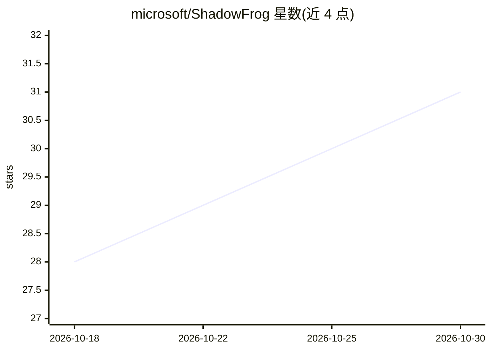

# microsoft/ShadowFrog

⭐ 31 · Python · MIT · 推送 2026-10-29 · [GitHub](https://github.com/microsoft/ShadowFrog) · 组织维护

**为编码 agent 构建代码库影子知识库的技能套件**

一套安装到代码仓库中的 AI 编码 agent 技能与钩子：将源码阅读、实验和对话中获得的行为性知识存入镜像源码树的 .shadow/ 目录，按符号组织为 Markdown 文件；查找走源码路径与 file::symbol 引用，不依赖向量索引或嵌入服务。提供 consult/update/dream/nap/meditate/viewer 七个斜杠命令工作流，Dream 在隔离 worktree 中运行自主实验，Nap 生成经独立 judge 审查的任务简报。支持 GitHub Copilot CLI 与 Claude Code，按仓库安装（Bash 或 PowerShell 安装器），需 Git 与 Python 3。自述为研究项目。

## 筛选速览

| 维度 | 判定 | 备注 |
|---|---|---|
| AI 角色 | `ai-ecosystem` | LLM/agent 周边工具 |
| 许可风险 | `permissive` | MIT |
| 部署形态 | `None` |  |
| 模型依赖 | — | README 未给出锁定关系 |
| 硬件要求 | — | 无带数字的原话,不猜 |
| 安装摩擦 | `low` | 无编译、无系统依赖或容器化 |
| 成熟度 | `idea` | |

## 能力要点

- .shadow/ 影子目录按符号组织存储行为性发现（状态/来源/标签/引用分）
- 索引无关查找：走源码路径与 file::symbol 引用，无向量索引或嵌入服务
- Dream 在隔离 git worktree 运行自主实验并产出分支，Nap 生成经 judge 审查的任务简报
- 信任层级与 citation_score 追踪：区分 user/interaction/exploration 来源

## 适用场景

- 让编码 agent 在改代码前查阅已积累的代码库隐性知识
- 离线时让 agent 自主跑实验并把发现沉淀为知识（Dream）
- 团队通过提交 .shadow/ 到仓库共享代码库知识
- 合并去重、审计知识结构完整性（meditate/viewer）

## 场景标签

`Agent 记忆` · 领域:Agent 开发

## 证据(README 行号)

> L3: ShadowFrog gives coding agents a **shadow knowledge base** for any codebase:
> L25: Install **per repository**, not globally. You need Git, Python 3, either GitHub

## 星数曲线

2026-10-18 28 → 2026-10-30 31（+3）

---
*卡片 v1 · prompt 1.4 · 生成 2026-10-26 · 置信度 high · 依据 README sha `33b574a1c2ea` · [字段定义](../../DATASET.md)*
