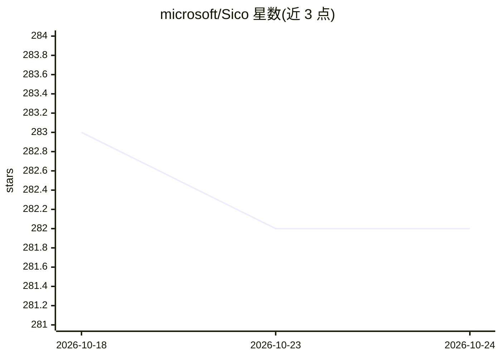

# microsoft/Sico

⭐ 282 · Python · MIT · 推送 2026-10-24 · [GitHub](https://github.com/microsoft/Sico) · 组织维护

**企业数字员工平台：构建、管理与持续进化 AI 劳动力**

微软开源的 Digital Worker 基础设施，面向 BPO 提供商与希望用 AI 规模化运营流程的企业。平台以 Cortex（LLM 推理规划）/Action（技能与沙箱工具）/Memory（长期记忆与知识库）结构组织数字员工，通过执行、进化、评估三个循环实现人机共同进化：Reflector→Curator 管线从任务轨迹提炼 Playbook 注入下次运行（免训练），也支持回流模型训练。技术栈为 Go 后端 + Python Core + React 前端，经 gRPC 通信；提供 LLM Hub 统一模型接入、Android/Linux 沙箱、RBAC、技能版本管理与经验学习。部署需 Docker Compose 或 Kubernetes(Helm)，并需至少一个 LLM API key；评估循环为规划中功能。

## 筛选速览

| 维度 | 判定 | 备注 |
|---|---|---|
| AI 角色 | `ai-ecosystem` | LLM/agent 周边工具 |
| 许可风险 | `permissive` | MIT |
| 部署形态 | `self-host` | docker 或自建部署 |
| 模型依赖 | locked-api |  |
| 硬件要求 | — | 无带数字的原话,不猜 |
| 安装摩擦 | `low` | 无编译、无系统依赖或容器化 |
| 成熟度 | — | 结构信号不足 |

## 能力要点

- Cortex/Action/Memory 结构化数字员工架构与四类协作角色
- Reflector→Curator 经验学习管线，免训练注入 Playbook 实现持续改进
- LLM Hub 统一接入 OpenAI/Azure/Anthropic/Gemini/OpenRouter 等模型
- Android 模拟器与 Linux 工作站沙箱池，含实时视图与操作轨迹

## 适用场景

- BPO 场景（黑盒测试、数据处理、客服、内容审核）中规模化运行 AI 劳动力
- 企业构建带人机协同监督与持续进化的自动化工作流
- 开发者注册、版本化管理并执行可复用的数字员工技能

## 场景标签

`Agent 框架` `Agent 记忆` `工作流自动化` · 领域:Agent 开发

## 证据(README 行号)

> L28: Sico — Symbiotic Intelligence for CO-evolution— is an open-source platform for building, managing, and evolving **D
> L109: - **Core**: agent reasoning, tool execution, LLM orchestration, experience accumulation.
> L121: - **LLM Hub**: unified model runtime with adapters for OpenAI, Azure OpenAI, Anthropic, Gemini, OpenRouter, OpenAI

## 星数曲线

2026-10-18 283 → 2026-10-24 282（-1）

---
*卡片 v1 · prompt 1.4 · 生成 2026-10-22 · 置信度 high · 依据 README sha `cfe46067d5b0` · [字段定义](../../DATASET.md)*
