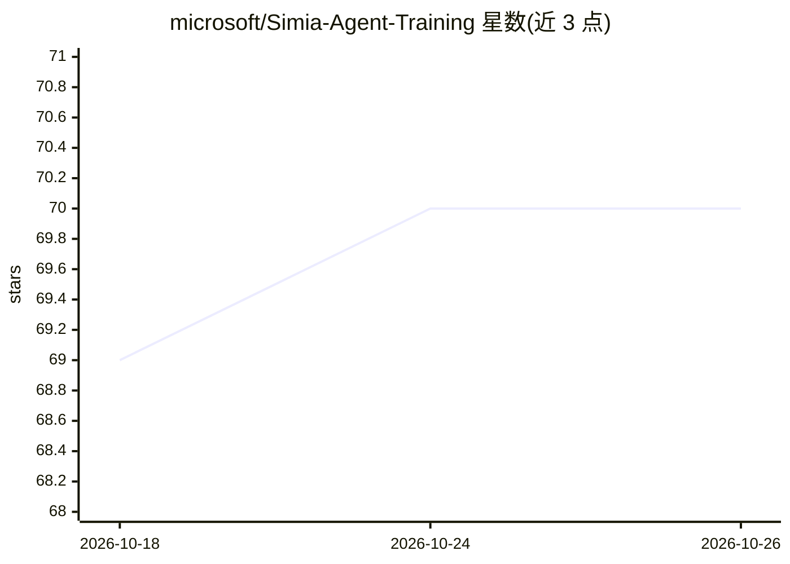

# microsoft/Simia-Agent-Training

⭐ 70 · Python · MIT · 推送 2026-02-18 · [GitHub](https://github.com/microsoft/Simia-Agent-Training) · 组织维护

**论文官方实现：用推理模型模拟环境做 agent 训练**

论文 Simulating Environments with Reasoning Models for Agent Training 的官方代码实现。仓库提供三部分：Simia_SFT 目录（用于 SFT 训练的模拟轨迹合成管线）、Simia-RL 目录（在模拟环境上做强化学习训练的框架），以及 tau2-bench 与 OfficeBench 评测目录。README 仅给出目录结构与跳转指引，具体安装与运行细节位于各子目录文档中，主页未列依赖或硬件要求。

## 筛选速览

| 维度 | 判定 | 备注 |
|---|---|---|
| AI 角色 | `ai-ecosystem` | LLM/agent 周边工具 |
| 许可风险 | `permissive` | MIT |
| 部署形态 | `None` |  |
| 模型依赖 | — | README 未给出锁定关系 |
| 硬件要求 | — | 无带数字的原话,不猜 |
| 安装摩擦 | `low` | 无编译、无系统依赖或容器化 |
| 成熟度 | — | 结构信号不足 |

## 能力要点

- 提供 SFT 训练用的模拟轨迹合成管线
- 提供在模拟环境上运行的 RL 训练框架
- 包含 tau2-bench 与 OfficeBench 评测代码

## 适用场景

- 复现论文中的模拟环境 agent 训练方法
- 基于模拟轨迹做 SFT 或 RL 训练实验
- 在 tau2-bench / OfficeBench 上评测训练出的 agent

## 场景标签

`强化学习` `微调` `模型评测` · 领域:评测与运维

## 证据(README 行号)

> L3: This repository contains the code implementation for the paper: Simulating Environments with Reasoning Models for Ag
> L7: - **Simia_SFT/**: Supervised Fine-Tuning (SFT) pipeline
> L10: - **Simia-RL/**: Reinforcement Learning (RL) framework

## 星数曲线

2026-10-18 69 → 2026-10-26 70（+1）

---
*卡片 v1 · prompt 1.4 · 生成 2026-10-24 · 置信度 high · 依据 README sha `448325484c32` · [字段定义](../../DATASET.md)*
