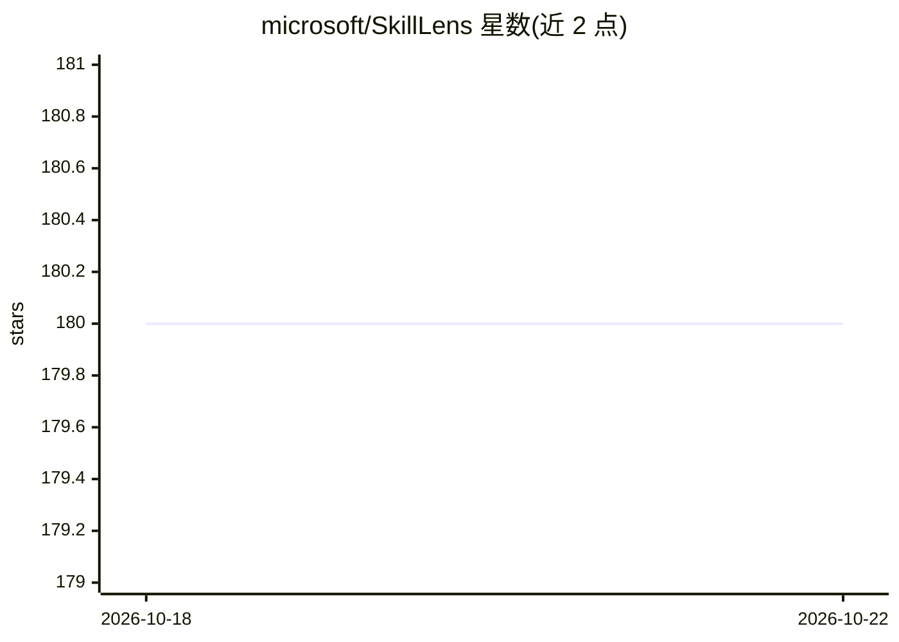

# microsoft/SkillLens

⭐ 180 · Python · MIT · 推送 2026-05-25 · [GitHub](https://github.com/microsoft/SkillLens) · [官网](https://microsoft.github.io/SkillLens/) · 组织维护

**研究模型生成 agent 技能全生命周期的评测框架**

用于系统性研究模型生成 agent 技能的框架，覆盖经验生成→技能抽取→技能消费四个阶段，各阶段对应 CLI 子命令（infer/convert/extract）。统一加载五个 agent 基准（SWE-bench Verified、ALFWorld、SpreadsheetBench、BFCL v4、SEAL-0）的轨迹，提供 sequential 与 parallel 两种技能抽取方法，并支持 Extraction Efficacy 与 Target Evolvability 指标的可复现评测。LLM 后端可配置 openai/azure/vllm/gemini。需 git clone 源码并以 conda Python 3.10 环境安装，各基准另需各自的数据下载与沙箱准备。

## 筛选速览

| 维度 | 判定 | 备注 |
|---|---|---|
| AI 角色 | `ai-ecosystem` | LLM/agent 周边工具 |
| 许可风险 | `permissive` | MIT |
| 部署形态 | `None` |  |
| 模型依赖 | local-ok | 支持本地模型 |
| 硬件要求 | — | 无带数字的原话,不猜 |
| 安装摩擦 | `low` | 无编译、无系统依赖或容器化 |
| 成熟度 | — | 结构信号不足 |

## 能力要点

- 四阶段流水线：经验生成、轨迹规范化、技能抽取、技能消费，各配 CLI 子命令
- 五种 agent 基准的统一轨迹加载与集成
- sequential 与 parallel 两种技能抽取方法
- 支持 openai/azure/vllm/gemini 多种 LLM provider 配置

## 适用场景

- 研究抽取出的技能对目标模型效果的影响因素
- 在不同 agent 基准上对比有/无技能注入的模型表现
- 复现论文中 Extraction Efficacy 与 Target Evolvability 指标评测

## 场景标签

`模型评测` · 领域:评测与运维

## 证据(README 行号)

> L12: **Skill***Lens* is a framework for systematically studying *model-generated agent skills* across their full lifecyc
> L21: - 📊 **Reproducible evaluation pipeline** for *Extraction Efficacy* and *Target Evolvability* metrics

## 星数曲线

2026-10-18 180 → 2026-10-22 180（+0）

---
*卡片 v1 · prompt 1.4 · 生成 2026-10-22 · 置信度 high · 依据 README sha `54327486d2c6` · [字段定义](../../DATASET.md)*
