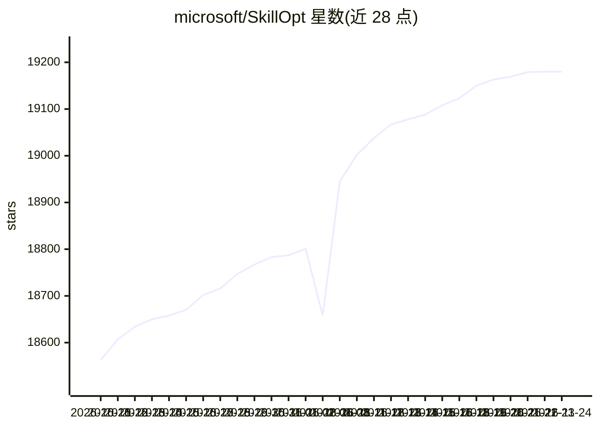

# microsoft/SkillOpt

⭐ 19,193 · Python · MIT · 推送 2026-11-23 · [GitHub](https://github.com/microsoft/SkillOpt) · [官网](https://aka.ms/skillopt) · 组织维护 · 中文 README

**为冻结参数的 LLM agent 训练可复用自然语言技能的优化器**

SkillOpt 把技能文档当作冻结 agent 的可训练状态：由单独的优化器模型将打分 rollout 转成对单个技能文档的有界增/删/改编辑，默认路径仅当候选编辑严格提升留出验证分数时才接受，辅以文本学习率预算、被拒编辑缓冲与按 epoch 的慢/元更新；部署产物为 300–2,000 token 的 best_skill.md，推理期零额外模型调用。通过 pip 安装，多后端（OpenAI 兼容/Claude/Qwen/MiniMax 等）与执行 harness（直接对话、Codex CLI、Claude Code CLI）可扩展，内置六基准与可选 WebUI 监控面板。

## 筛选速览

| 维度 | 判定 | 备注 |
|---|---|---|
| AI 角色 | `ai-ecosystem` | LLM/agent 周边工具 |
| 许可风险 | `permissive` | MIT |
| 部署形态 | `library` | 以包/库形式分发 |
| 模型依赖 | — | README 未给出锁定关系 |
| 硬件要求 | — | 无带数字的原话,不猜 |
| 安装摩擦 | `low` | 无编译、无系统依赖或容器化 |
| 成熟度 | — | 结构信号不足 |

## 动量与使用信号

- 维护:`active` — 距上次 push 11.6 天,年发版 2,68 位贡献者
- 涨星:近 1 天 **+39**(自 20261016 起算)
- 安装:pypi 包 `skillopt` 月下载 12,972
- 平台:WINDOWS / WEB · 协议:MCP

## 能力要点

- 技能文档即可训练状态：rollout→reflect→aggregate→select→update→evaluate 训练循环
- 验证门控编辑接受与文本学习率预算，部署产物为 best_skill.md（约 300–2,000 token）
- 多后端支持（OpenAI/Azure/Claude/Qwen/MiniMax 及 openai_compatible），可注册新后端与新基准
- skillopt-sleep 夜间离线自演化 CLI 与可选 Gradio WebUI 仪表盘

## 适用场景

- 为冻结的 coding agent 离线训练并沉淀可复用任务技能
- 在多个 LLM 后端与执行 harness 间迁移已优化的技能文档
- 用 WebUI 监控技能训练过程

## 场景标签

`Agent 框架` · 领域:Agent 开发

## 证据(README 行号)

> L30: **SkillOpt treats the skill document as the trainable state of a frozen
> L32: optimization reproducible. A separate optimizer model turns scored rollouts
> L61: A backend = a chat / exec target (e.g. `openai_chat`, `claude_chat`,

## 星数曲线

2026-10-21 18,563 → 2026-11-24 19,180（+617）

---
*卡片 v1 · prompt 1.4 · 生成 2026-11-22 · 置信度 high · 依据 README sha `0551eb5c3d03` · [字段定义](../../DATASET.md)*
